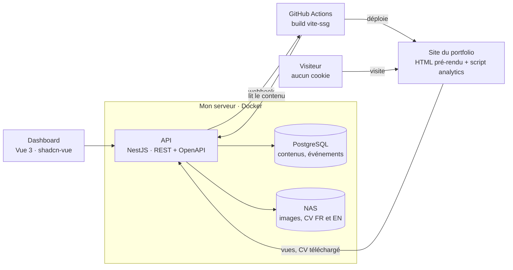
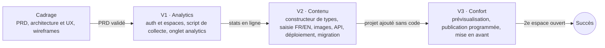

# PRD — CMS personnel

2 novembre 2026 · Costa Maskulov

## Résumé et objectifs

Un CMS headless auto-hébergé pour gérer, depuis un seul dashboard, le contenu et l'audience de mes sites et de ceux de mes proches ou clients, sans toucher au code. Le nom reste à trouver.

Pourquoi le construire moi-même plutôt qu'utiliser Strapi ou Directus :

1. Montrer des compétences back-end et consolider mon positionnement full stack.
2. Gérer tous mes sites qui en ont besoin avec un outil taillé à 100 % pour mon besoin.
3. Pouvoir ajouter à tout moment une fonctionnalité à laquelle je n'avais pas pensé.
4. Avoir un projet de plus pour mon portfolio, avec sa propre étude de cas destinée aux recruteurs.

Le projet est réussi si, dans 6 mois :

- j'ajoute un projet et je le vois en ligne sur mon portfolio sans ouvrir mon éditeur de code ;
- l'onglet analytics me montre quels projets font le plus d'effet, d'où viennent les visiteurs et si mon CV a été téléchargé ;
- le CMS gère au moins un autre site, ou l'espace d'une autre personne.

## Utilisateurs, espaces et rôles

Une seule instance du CMS tourne sur mon serveur. Chaque site a son espace, et il n'existe que deux niveaux d'accès.

| Rôle | Qui | Peut faire |
| --- | --- | --- |
| Super-admin | Moi | Tout : créer les espaces, définir les types de contenu de chaque espace, inviter des membres, réinitialiser un mot de passe, gérer le contenu et voir les analytics de tous les espaces |
| Membre d'espace | Un proche ou un client, une ou plusieurs personnes par espace | Ajouter, modifier et publier le contenu de son espace, voir ses analytics |

Tous les membres d'un même espace ont les mêmes droits. Un membre ne modifie jamais la structure (les types de contenu et leurs champs) : c'est moi qui la crée pour lui.

Je gère seul les espaces de mes propres sites.

## Périmètre et non-objectifs

Le CMS gère du contenu et mesure l'audience, rien de plus. Les analytics arrivent en premier : le portfolio sortira avec un contenu codé en dur et collectera des stats pendant que je développe la partie contenu (ordre à valider).

| Fonctionnalité | Version |
| --- | --- |
| Connexion email + mot de passe, double authentification TOTP facultative | V1 |
| Espaces, membres, invitations et réinitialisation par lien à usage unique | V1 |
| Script de collecte et package client pour les sites | V1 |
| Onglet analytics : période, temps réel, export CSV | V1 |
| Exclusion de mes visites et du mode preview | V1 |
| Constructeur de types de contenu dans le dashboard | V2 |
| Saisie FR/EN côte à côte avec sauvegarde automatique | V2 |
| Brouillon / publié | V2 |
| Images (texte alternatif obligatoire) et CV en FR et en EN | V2 |
| API publique de lecture | V2 |
| URL de déploiement par espace, appelée à chaque publication | V2 |
| Migration du contenu actuel du portfolio | V2 |
| Prévisualisation des brouillons sur le vrai site | V3 |
| Publication programmée | V3 |
| Mise en avant automatique des projets | V3 |

Le CMS ne fait pas (à valider) :

- le back-end complet d'une application (comptes utilisateurs, commandes, paiements, logique métier) ;
- d'autres langues que le français et l'anglais ;
- la traduction automatique ;
- les vidéos et les fichiers autres que les images et le CV ;
- les tags et catégories (prévus plus tard) ;
- l'historique des versions d'un contenu ;
- les notifications ;
- les liens tracés par candidature ;
- des rôles différents au sein d'un même espace ;
- l'envoi d'emails en V1.

## Contenus et édition

Chaque espace a ses types de contenu, que je crée dans le dashboard ; un type a des champs fixes, et un membre ne fait que remplir ces champs.

### Types de contenu

- Un type est soit une collection (plusieurs entrées : projets, expériences), soit une page unique (accueil, à propos).
- L'ordre d'affichage est géré par le site, pas par le CMS.

### Types de champs nécessaires dès la V2

| Champ | Usage dans le portfolio |
| --- | --- |
| Texte court | Titre, accroche, rôle, libellé |
| Texte riche | Paragraphes de contexte, de besoin, de conclusion |
| Liste de choix | Type de projet (perso, école, entreprise, client) |
| Date ou période (avec « en cours ») | Durée d'un projet ou d'une expérience |
| Lien | Code, démo |
| Liste de valeurs | Stack |
| Nombre | Valeurs « avant » et « après » d'un résultat |
| Image | Visuel principal, texte alternatif obligatoire |
| Groupe répétable | Contraintes, étapes de méthode, choix techniques, résultats, enseignements |

Chaque champ peut être obligatoire ou facultatif, et traduisible ou non.

### Langues

- Toujours FR et EN, saisis côte à côte.
- Traduction manuelle.
- Un contenu dont la version EN est incomplète est masqué sur le site en anglais ; le dashboard signale les traductions manquantes.

### Médias

- Images uniquement, stockées sur le NAS de mon serveur.
- Le CV est un fichier par langue, remplacé sans historique.

### Publication

- Brouillon ou publié.
- Sauvegarde automatique pendant la saisie.
- Prévisualisation et publication programmée en V3.
- Mon scénario cible : dans la section Projets, je clique sur « Ajouter un projet », je remplis les champs FR/EN, puis je choisis « Brouillon » ou « Publier ».

## Le type « Projet » du portfolio

La structure d'une étude de cas est toujours la même ; c'est le premier type que le constructeur doit savoir reproduire, et il sert de test d'acceptation de la V2.

| Section | Champs | Type de champ |
| --- | --- | --- |
| En-tête | Type de projet, titre, accroche, lien vers le code, lien vers la démo | Liste de choix, texte court, texte court, lien, lien |
| Fiche | Rôle, durée (début, fin ou « en cours »), équipe, stack | Texte court, période, texte court, liste de valeurs |
| Visuel | Image principale + texte alternatif | Image |
| Contexte | Phrase d'accroche + paragraphe | Texte court + texte riche |
| Besoin | Phrase d'accroche + paragraphe | Texte court + texte riche |
| Contraintes | Titre, description | Groupe répétable |
| Méthode | Intro + étapes ordonnées (titre, description) | Texte court + groupe répétable |
| Choix techniques | Titre, description, compromis | Groupe répétable |
| Résultats | Valeur (texte libre), libellé, comparaison facultative avant / après en nombres ; texte de conclusion | Groupe répétable + texte riche |
| Enseignements | Titre, description | Groupe répétable |

Le bouton de téléchargement du CV en fin d'étude de cas est un élément du site, pas un champ : il sert à mesurer la conversion (voir Analytics).

Les autres types du portfolio (expériences, parcours, compétences, textes du site) seront définis pendant la phase d'architecture.

## Analytics

Les analytics mesurent quels projets convertissent en téléchargement du CV et d'où viennent les visiteurs, sans cookies ni données personnelles, donc sans bandeau de consentement.

### Événements collectés (identiques pour tous les espaces)

| Événement | Données enregistrées |
| --- | --- |
| Vue de page | Page, site de provenance (LinkedIn, GitHub, Google, accès direct…), date et heure |
| Téléchargement du CV | Page d'où il a été téléchargé, date et heure |

Pas de langue, pas de type d'appareil, pas de pays, pas de distinction entre CV FR et EN.

### Vie privée

- Aucun cookie et aucun identifiant stocké chez le visiteur.
- Un visiteur n'est pas reconnu d'un jour à l'autre.
- Mes visites sont exclues par un réglage « ne pas me compter » activé depuis le dashboard, qui pose un marqueur dans mon navigateur ; le script le lit et n'envoie rien.
- Les visites en mode preview ne sont jamais comptées.
- Tout événement de plus de 6 mois est supprimé, sans agrégat conservé.

### Score d'effet et mise en avant (V3)

Le score d'un projet est son taux de conversion sur les 6 derniers mois : téléchargements du CV depuis sa page, divisés par ses vues. Le classement porte sur des taux, pas des volumes, pour éviter qu'un projet déjà mis en avant le reste parce qu'il est plus vu.

- Les 3 projets au meilleur score sont mis en avant.
- Un projet n'est classé qu'à partir d'un seuil de vues (20 par défaut, à valider).
- Si moins de 3 projets atteignent le seuil, les places restantes sont tirées au hasard.

### Onglet analytics

- Choix de la période, dans la limite des 6 mois conservés.
- Activité en temps réel.
- Export CSV.
- Pour un membre d'espace : uniquement les analytics de son espace.

## Architecture technique

Le dashboard et les sites ne parlent qu'à l'API. À chaque publication, l'API appelle l'URL de déploiement de l'espace : GitHub Actions relit le contenu publié, build le site avec vite-ssg et le déploie. Si le CMS tombe, les sites restent consultables tant qu'ils ne sont pas hébergés sur la même machine ; seules l'édition et la collecte s'arrêtent.

### Organisation du code (monorepo, npm workspaces)

- `apps/api` : l'API.
- `apps/dashboard` : le dashboard.
- `packages/client` : le package installé par les sites, qui récupère le contenu au build et contient le script analytics.
- `packages/shared` : types et schémas de validation partagés entre les trois.

### Choix techniques

| Brique | Choix | Statut |
| --- | --- | --- |
| API | Node + TypeScript, NestJS | Langage décidé, framework à valider |
| Style d'API | REST, documentation OpenAPI générée | Recommandé |
| Base de données | PostgreSQL ; les entrées en JSONB, validées par le schéma de leur type | Décidé ; ORM à valider |
| Dashboard | Vue 3 + Vite + TypeScript, shadcn-vue | Recommandé |
| Temps réel de l'onglet analytics | Server-sent events | Recommandé |
| Images | NAS monté dans le conteneur ; WebP et AVIF en 640, 1280 et 1920 px ; 10 Mo maximum | Recommandé |
| Hébergement | Docker Compose derrière Nginx Proxy Manager, sur mon serveur Proxmox | Décidé |
| Build des sites | Une URL de déploiement par espace ; GitHub Actions + vite-ssg pour le portfolio | Recommandé |
| Prévisualisation (V3) | Route preview côté site qui lit les brouillons avec un jeton privé | Recommandé |

## Sécurité, données et RGPD

J'héberge le contenu de mes proches et clients et l'audience de leurs sites : je suis leur sous-traitant au sens du RGPD, et je l'accepte.

- Mots de passe hachés (Argon2 ou bcrypt), sessions sécurisées, double authentification TOTP facultative.
- Liens d'invitation et de réinitialisation à usage unique, avec une durée de validité courte.
- Chaque requête vérifie que l'utilisateur appartient à l'espace concerné ; un membre ne voit jamais les données d'un autre espace.
- Le site lit le contenu publié avec une clé API en lecture seule, propre à son espace.
- L'endpoint de collecte est public : limitation du débit, validation stricte des événements, filtrage des robots.
- Les fichiers envoyés sont vérifiés (type réel, 10 Mo maximum).
- Aucune donnée personnelle de visiteur n'est stockée.
- Une perte de données est acceptable pour moi ; souhaitable : un dump quotidien de la base vers le NAS, pour protéger le contenu des autres espaces.
- À rédiger avant d'ouvrir un espace à quelqu'un : un court accord de sous-traitance et le texte de mentions légales à mettre sur son site.

## Exigences non fonctionnelles et critères d'acceptation

Les cibles chiffrées ci-dessous sont des propositions à valider ; elles serviront de résultats dans l'étude de cas.

| Critère | Cible | Vérification |
| --- | --- | --- |
| Ajouter un projet complet en FR et EN | Moins de 20 min | Chronométré sur un vrai projet |
| Délai entre publication et site en ligne | Moins de 5 min | Horodatage du webhook et du déploiement |
| Accessibilité du dashboard | WCAG 2.2 AA, Lighthouse accessibilité ≥ 95 | Audit Lighthouse + tests au clavier |
| Couverture de tests de l'API | ≥ 70 % | Rapport de couverture en CI |
| Poids du script analytics | Moins de 2 Ko compressé | Mesure du bundle |
| Budget | 0 € | Aucun service payant |

Exigences de qualité, car le projet est une vitrine :

- CI GitHub Actions sur chaque PR : lint, tests, build.
- Tests unitaires et d'intégration sur l'API, quelques tests de bout en bout sur le dashboard.
- Documentation OpenAPI générée et README d'installation.
- Workflow Git habituel : `main` pour les versions, `dev` pour l'intégration, branches `<type>/<cible>/<action>` (ex. `feat/dev/schema_bdd`), PR, Conventional Commits en français.
- Dépôt privé pendant le développement, publié à la fin sous licence MIT.
- Dashboard minimaliste et neutre, construit avec une bibliothèque de composants accessibles (par exemple shadcn-vue), sans direction artistique dédiée.

## Roadmap et jalons

Je travaille quelques heures par semaine sur le projet : chaque jalon tient en une session et se termine par une PR mergée dans `dev`. Le CMS sort après la première version du portfolio, sans échéance.

Prochains jalons du cadrage :

1. Trancher les décisions à valider de ce PRD.
2. Schéma de la base : espaces, membres, types, entrées, médias, événements.
3. Routes de l'API et format des événements analytics.
4. Arborescence et wireframes du dashboard.
5. Initialisation du monorepo, de la CI et du Docker Compose.

## Décisions à valider et questions ouvertes

Ces points sont des propositions reprises par défaut ; je les coche une fois tranchés.

- [ ] Ordre des versions : analytics en V1, contenu en V2, confort en V3.
- [ ] Liste des non-objectifs.
- [ ] Cibles chiffrées des critères d'acceptation.
- [ ] Seuil de vues pour classer un projet (20 par défaut).
- [ ] Framework de l'API : NestJS recommandé, Fastify en alternative plus légère.
- [ ] ORM : Prisma, Drizzle ou SQL écrit à la main.
- [ ] Méthode allégée pour le CMS : PRD, architecture et UX, wireframes, code, sans territoire de marque ni DA.
- [ ] Projets mis en avant : tirage au build (identique pour tous jusqu'au prochain build) ou dans le navigateur (différent à chaque visite).
- [ ] Nom du CMS.
- [ ] Types de contenu du portfolio autres que « Projet » : expériences, parcours, compétences, textes du site.
