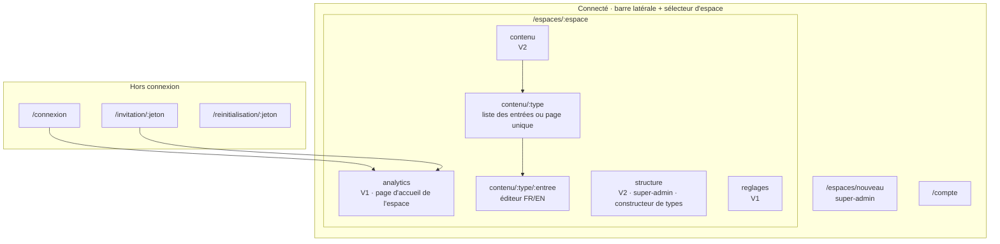
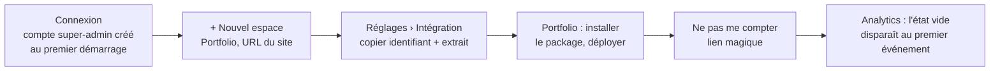
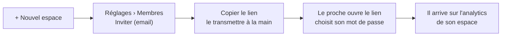
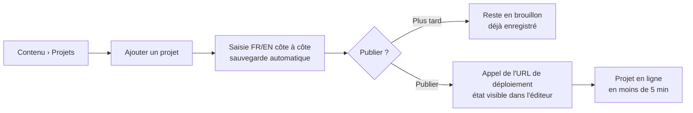
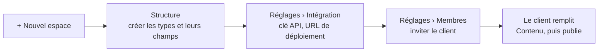

# Architecture de contenu et UX — dashboard de Dashility

4 novembre 2026, complété le 6 novembre 2026 pour la V2, le 11 novembre 2026 pour la refonte de Contenu et Structure puis pour la prévisualisation, et le 12 novembre 2026 pour la mise en avant · s'appuie sur `01-PRD.md` et `decisions.md`

Ce document organise les écrans et les parcours du dashboard. Les écrans V1 et V2 sont détaillés (wireframes et états), ainsi que toute la V3 : publication programmée, prévisualisation et mise en avant.

Méthode allégée : pas de territoire de marque. Le dashboard est construit avec shadcn-vue (PRD, « Exigences de qualité ») ; sa direction visuelle, légère, est dans `03-direction-artistique.md` depuis le 11 novembre 2026.

## Principes

- **Interface en français uniquement.** Le contenu géré est en FR et en EN, mais le dashboard lui-même ne parle que français.
- **Un espace à la fois.** Toute la navigation se fait dans le contexte d'un espace, choisi avec le sélecteur d'espace. Un membre peut appartenir à plusieurs espaces.
- **On arrive là où on s'était arrêté.** Après la connexion : l'analytics du dernier espace ouvert (le seul espace pour un membre qui n'en a qu'un).
- **Pas d'email en V1.** Les liens d'invitation et de réinitialisation s'affichent dans le dashboard ; le super-admin les copie et les transmet à la main.
- **Un espace interdit n'existe pas.** Un membre qui ouvre l'URL d'un espace dont il n'est pas membre reçoit une page 404, pas une 403, pour ne pas révéler son existence.
- **Utilisable sur mobile.** L'analytics doit pouvoir se consulter sur téléphone : la barre latérale devient un tiroir sous 768 px.

## Arborescence



### URLs

| URL | Qui | Version |
| --- | --- | --- |
| `/connexion` | Tous | V1 |
| `/invitation/:jeton` | Invité | V1 |
| `/reinitialisation/:jeton` | Membre ou super-admin | V1 |
| `/espaces/nouveau` | Super-admin | V1 |
| `/espaces/:espace/analytics` | Membres de l'espace | V1 |
| `/espaces/:espace/reglages` | Membres de l'espace (sections réduites pour un membre) | V1 |
| `/compte` | Tous | V1 |
| `/espaces/:espace/contenu`, `…/contenu/:type`, `…/contenu/:type/:entree` | Membres de l'espace | V2 |
| `/espaces/:espace/structure` | Super-admin | V2 |

`:espace` est le slug de l'espace (ex. `portfolio`).

## Mise en page commune (connecté)

```
┌──────────────────┬─────────────────────────────────────────────┐
│ [Portfolio    ▾] │  Analytics                                   │
│                  │                                              │
│  Analytics       │  (contenu de l'écran)                        │
│  Contenu    V2   │                                              │
│  Structure  V2 ★ │                                              │
│                  │                                              │
│  Réglages        │                                              │
│                  │                                              │
│ ──────────────── │                                              │
│  Costa M.     ▾  │                                              │
│   Mon compte     │                                              │
│   Déconnexion    │                                              │
└──────────────────┴─────────────────────────────────────────────┘
★ visible par le super-admin uniquement
```

- **Sélecteur d'espace** : liste des espaces du compte, recherche si plus de 5 espaces, et une entrée « + Nouvel espace » pour le super-admin. Si le compte n'a qu'un espace, le sélecteur devient un simple titre. Chaque espace est précédé du favicon de son site (`<site>/favicon.ico`), ou de l'initiale de son nom si le site n'en a pas.
- **Contenu dans la barre latérale** : sous « Contenu », la liste des types (collections puis pages, dans l'ordre de Structure), chacun ouvrant sa liste d'entrées ou son éditeur en un clic. Le type ouvert est mis en évidence. La liste est dépliée tant qu'on est dans Contenu, repliée ailleurs ; un chevron permet de la déplier à la main.
- **Densité** : les listes d'éléments (types, entrées, champs) sont des lignes, pas des cartes ; une carte est réservée à un bloc qui regroupe plusieurs informations (indicateurs de l'analytics, éditeur). Le contenu des écrans garde sa largeur maximale actuelle (environ 1 000 px) : les lignes la remplissent, au lieu de cartes étirées.
- **Une action principale par écran**, en haut à droite, à côté du titre (« Ajouter un projet », « Nouveau type », « Publier »).
- Lien d'évitement « Aller au contenu » en premier élément focusable.
- Titre de l'onglet du navigateur : `<Écran> · <Espace> · Dashility`.

## Écrans V1

### Connexion

```
┌──────────────────────────────┐
│ Connexion                    │
│ Email        [____________]  │
│ Mot de passe [____________]  │
│ [ Se connecter ]             │
│                              │
│ Mot de passe oublié ?        │
│ Demandez un lien de          │
│ réinitialisation à votre     │
│ administrateur.              │
└──────────────────────────────┘
```

- Erreur d'identifiants : un message unique (« Email ou mot de passe incorrect »), sans dire lequel des deux est faux.
- Trop de tentatives : message « Trop de tentatives, réessayez dans quelques minutes ».
- Session expirée sur un écran connecté : retour à `/connexion`, puis retour à l'écran d'origine après la connexion.

### Invitation et réinitialisation

Les deux écrans ont la même forme : l'email est affiché en lecture seule, avec deux champs « Nouveau mot de passe » et « Confirmer ».

- **Invitation acceptée** : le compte est créé, l'utilisateur est connecté et arrive sur l'analytics de l'espace.
- **Réinitialisation réussie** : l'utilisateur est connecté et arrive sur son dernier espace ouvert.
- **Jeton expiré ou déjà utilisé** : la page dit « Ce lien n'est plus valide, demandez-en un nouveau à votre administrateur », sans formulaire.
- **Durées de validité proposées** : 72 h pour une invitation, transmise à la main, donc parfois lue tard ; 24 h pour une réinitialisation.

### Analytics (page d'accueil d'un espace)

Maquette : `06-maquettes/refonte-analytics.html` (captures `analytics.png`, `analytics-mobile.png`, `analytics-survol.png`).

```
Analytics                              [30 derniers jours ▾] [Exporter en CSV]
Comparé aux 30 jours précédents (14 sept. – 13 oct.)
┌ ■ Vues ─────────┐ ┌ ■ CV téléchargés ┐ ┌ Taux de conversion ┐
│ 1 163           │ │ 36               │ │ 3,1 %              │
│ ↑ +15 % 1 012 avant │ ↑ +33 % 27 avant │ │ ↑ +0,4 pt 2,7 % avant │
└─────────────────┘ └──────────────────┘ └────────────────────┘
┌ ● 12 vues ces 30 dernières minutes · Dernier événement à 14:02 … [Voir le flux ▾] ⏸ ┐
┌ Par jour ─────────────────────────────────────────── [Voir en tableau] ┐
│ Vues            ╱╲  96 · 29 oct.                                       │
│ 100 ┼──────────╱──╲──────────────────────────────                      │
│   0 ┼─╱╲_╱╲___╱    ╲__╱╲___╱╲_                                         │
│ CV téléchargés  ▮ ▮  ▮▮▮    ▮ ▮▮                                       │
│        19 oct.      26 oct.      2 nov.      9 nov.                    │
└────────────────────────────────────────────────────────────────────────┘
┌ Pages · 34 pages vues ── Vues↓ CV  Taux ┐ ┌ Provenances ──── Vues Part ┐
│ /fr                       412   4   1 % │ │ LinkedIn          486  41 % │
│ ━━━━━━━━━━━━━━━━━━━━━                   │ │ ━━━━━━━━━━━━━              │
│ … 10 lignes                             │ │ … 5 sources                 │
│        [Afficher les 34 pages]          │ │ 4 autres sources   29   2 % │
└─────────────────────────────────────────┘ └─────────────────────────────┘
┌ Mise en avant · Projets ─ sur les 6 derniers mois (voir plus bas) ┐
```

- **Période** : 7 derniers jours, 30 derniers jours (valeur par défaut), 6 mois, ou personnalisée. Le calendrier ne propose que les 6 derniers mois, puisque rien n'est conservé au-delà.
- **Comparaison** : la période est comparée à celle qui la précède, de même durée (« Comparé aux 30 jours précédents (14 sept. – 13 oct.) »). Si cette période précédente commence avant les 6 mois conservés (par exemple pour « 6 mois »), il n'y a ni phrase ni évolution.
- **Tuiles** : vues, CV téléchargés, taux de conversion (CV ÷ vues) sur la période, chacune avec son évolution : flèche, signe et pourcentage (en points pour le taux), puis la valeur d'avant (« 1 012 avant »). La hausse est en vert, la baisse en rouge ; la flèche et le signe portent le sens sans la couleur. Sans valeur d'avant (0), pas de pourcentage, seulement « 0 avant ».
- **Temps réel** : une ligne sous les tuiles, avec le nombre de vues des 30 dernières minutes et le dernier événement. « Voir le flux » déplie les 20 derniers événements. Comme il n'existe pas d'identifiant de visiteur, on affiche des **événements**, jamais des « visiteurs actifs ». Un bouton pause arrête la mise à jour automatique (WCAG 2.2.2), et le flux n'est pas annoncé par les lecteurs d'écran pour ne pas les saturer. Sous 768 px, le dernier événement est masqué.
- **Par jour** : les vues en courbe (axe gradué, pic indiqué), les CV en barres juste en dessous, sur les mêmes dates. Deux graphiques et non un seul à deux axes : les échelles sont trop différentes. Un curseur commun, à la souris ou aux flèches du clavier, donne le jour, les vues, les CV et le taux. Le bouton « Voir en tableau » affiche les mêmes données en tableau, comme alternative accessible.
- **Pages** : les 10 pages les plus vues, puis « Afficher les N pages ». Vues, téléchargements du CV et taux par page, triables, avec les vues décroissantes par défaut ; une barre fine sous le chemin donne l'ordre de grandeur des vues.
- **Provenances** : site d'origine regroupé (LinkedIn, GitHub, Google, Accès direct, sinon le nom de domaine), avec les vues, leur part et une barre fine. Les 5 premières, puis une ligne « N autres sources ».
- **Panneaux** : chaque bloc vit dans un panneau blanc, sur le fond gris (`03-direction-artistique.md`).
- **Export CSV** : les événements bruts de la période, une ligne par événement (`date, type, page, provenance`).

**États**

| État | Affichage |
| --- | --- |
| Chargement | Squelettes à la place des tuiles, de la courbe et des tableaux |
| Aucun événement jamais reçu | Message « Aucune donnée pour l'instant » et lien vers Réglages › Intégration pour installer le script |
| Période sans données | Tuiles à 0, et message « Aucune visite sur cette période » à la place de la courbe et des tableaux |
| Erreur de chargement | Message et bouton « Réessayer » ; les autres blocs restent affichés |
| Temps réel interrompu | Pastille « Reconnexion… » dans la ligne du temps réel ; reconnexion automatique |
| Premier événement reçu | L'état vide est remplacé sans recharger la page |

### Réglages d'un espace

Une seule page, en sections. Un membre ne voit que la section « Ne pas me compter ».

```
Réglages
├─ Général ★            Nom, slug, URL du site          [Enregistrer]
├─ Membres ★            Liste : email, statut (actif, invité), actions
│                       [Inviter un membre]
├─ Intégration ★        Identifiant public de l'espace  [Copier]
│                       Extrait d'installation du package [Copier]
├─ Ne pas me compter    [Ouvrir le site et m'exclure]
│                       [Ouvrir le site et me compter à nouveau]
└─ Zone de danger ★     [Supprimer l'espace]
★ super-admin uniquement
```

**Membres**

- **Inviter** : champ email, puis génération d'un lien à usage unique affiché avec un bouton « Copier ». Le membre apparaît « invité » jusqu'à ce qu'il accepte.
- **Email qui a déjà un compte** : il est ajouté directement à l'espace, sans lien, puisqu'il peut se connecter avec ses identifiants actuels.
- **Actions par membre** : générer un lien de réinitialisation, retirer de l'espace, régénérer ou annuler une invitation en attente.
- **Super-admin** : il n'apparaît pas dans la liste et ne peut pas être retiré.

**Ne pas me compter (lien magique)**

Le dashboard ne peut pas écrire dans le stockage d'un site qui n'est pas sur son domaine. Le bouton ouvre donc le site dans un nouvel onglet avec le paramètre `?dashility-ignore=1`. Le script de collecte lit ce paramètre, enregistre le marqueur dans le `localStorage` du site, retire le paramètre de l'URL et affiche une courte confirmation (« Vos visites ne sont plus comptées sur ce navigateur »). `?dashility-ignore=0` annule l'exclusion. L'opération se fait une fois par navigateur et par site.

N'importe qui peut ajouter ce paramètre à l'URL, mais il ne peut exclure que lui-même : il n'y a donc aucun risque.

**Supprimer l'espace** : il faut retaper le nom de l'espace pour confirmer. Les membres qui n'appartiennent à aucun autre espace perdent l'accès.

### Nouvel espace

Champs : nom, slug (pré-rempli depuis le nom), URL du site. Après la création, on arrive sur Réglages › Intégration pour installer le script.

### Mon compte

- Email (lecture seule en V1).
- Changer le mot de passe : mot de passe actuel, nouveau mot de passe, confirmation.

## Écrans V2

La V2 ajoute le contenu. Le super-admin définit des **types** dans Structure ; les membres remplissent des **entrées** dans Contenu.

### Principes de la V2

- **Le site ne montre jamais un texte à moitié écrit.** La saisie est sauvegardée automatiquement, mais elle reste un brouillon tant qu'on n'a pas cliqué sur « Publier ». Sur une entrée déjà publiée, les modifications sont gardées à part et le site garde l'ancienne version jusqu'à « Publier les modifications ».
- **FR et EN côte à côte, champ par champ.** Chaque champ traduisible a sa colonne FR et sa colonne EN sur la même ligne : on traduit en regardant l'original. Un champ non traduisible occupe toute la largeur, une seule fois. Un sélecteur « Côte à côte · Français · English » en haut de l'éditeur permet aussi de n'afficher qu'une langue, sur toute la largeur, pour avoir la place d'écrire ; il bascule tous les champs à la fois.
- **Le français est la langue de référence.** Publier exige les champs obligatoires en français. Une version anglaise incomplète n'empêche pas de publier : l'entrée est masquée sur le site en anglais (PRD, « Langues ») et le dashboard le signale partout où elle apparaît.
- **Pas de médiathèque.** Une image s'envoie directement dans son champ, avec ses textes alternatifs.
- **Les fichiers sont des champs.** Le CV n'a pas d'écran à lui : c'est une page unique « CV » avec un champ « Fichier PDF » traduisible, donc un fichier FR et un fichier EN. Un espace sans CV n'a pas d'écran inutile.

### Statuts d'une entrée

| Statut | Badge dans les listes | Ce que voit le site |
| --- | --- | --- |
| Brouillon | « Brouillon » | Rien |
| Publié | « Publié » | La version publiée |
| Publié, avec des modifications en attente | « Publié » + « Modifications non publiées » | La version publiée, sans les modifications |

Le badge « EN incomplet » s'ajoute quand un champ obligatoire traduisible n'a pas sa valeur anglaise (texte alternatif d'une image compris).

### Contenu

L'écran répond à deux questions : « qu'est-ce qui reste à faire ? » et « où est tel contenu ? ». Il remplace les grandes cartes par type (une par ligne de grille, avec seulement le statut), qui prenaient beaucoup de place pour peu d'information.

```
Contenu

À traiter                                                              4
┌──────────────────────────────────────────────────────────────────────┐
│ Projets › Dashility          Brouillon · EN incomplet     il y a 2 h │
│ Parcours › Alternance        Modifications non publiées   hier       │
│ Projets › Ce portfolio       Programmé le 12 nov. à 09:00  hier      │
│ Qui je suis                  EN incomplet                  9 nov.    │
└──────────────────────────────────────────────────────────────────────┘

Collections
┌──────────────────────────────────────────────────────────────────────┐
│ Projets   4 publiés · 1 brouillon · 1 EN incomplet  hier   [+ Ajouter] │
│ Parcours  8 publiés                                 3 nov. [+ Ajouter] │
└──────────────────────────────────────────────────────────────────────┘

Pages
┌──────────────────────────────────────────────────────────────────────┐
│ Compétences        Publiée                              9 nov.       │
│ Qui je suis        Publiée · EN incomplet               9 nov.       │
│ Mon histoire       Publiée                              8 nov.       │
│ …                                                                    │
└──────────────────────────────────────────────────────────────────────┘
```

**À traiter** : les entrées qui demandent une action, toutes collections et pages confondues.

- Y figurent : un brouillon jamais publié, une entrée publiée avec des modifications non publiées, une entrée « EN incomplet » (masquée sur le site en anglais), une publication programmée (pour mémoire, avec sa date).
- Une ligne par entrée : `Type › Titre` (le titre d'une page unique est le nom de son type), ses badges, sa dernière modification. Toute la ligne ouvre l'éditeur.
- Tri : dernière modification d'abord. Au-delà de 8 lignes, « Tout afficher (12) » déplie le reste sur place.
- Le compteur à côté du titre donne le nombre total d'entrées à traiter.
- Rien à traiter : « Tout est publié et traduit. » à la place de la liste, sur une ligne.

**Collections** : une ligne par collection, dans l'ordre de Structure.

- Nom, compteurs en pastilles de statut (publiés, brouillons, modifiés, programmés, EN incomplet ; un compteur à zéro n'est pas affiché, sauf « 0 entrée »), dernière modification d'une de ses entrées.
- Bouton « Ajouter » (nom complet pour les lecteurs d'écran : « Ajouter un projet », avec le nom d'une entrée du type) : crée l'entrée et ouvre l'éditeur, sans passer par la liste.
- Le reste de la ligne ouvre la liste des entrées.

**Pages** : une ligne par page unique, dans l'ordre de Structure ; badges de statut et dernière modification. La ligne ouvre l'éditeur.

- Sur mobile, chaque ligne passe sur deux lignes (nom et action, puis badges et date) .
- Les types apparaissent aussi sous « Contenu » dans la barre latérale (voir « Mise en page commune »).

| État | Affichage |
| --- | --- |
| Aucun type (super-admin) | « Cet espace n'a pas encore de type de contenu » et bouton « Créer un type » vers Structure |
| Aucun type (membre) | « Le contenu de cet espace n'est pas encore prêt. Votre administrateur doit d'abord le configurer. » |
| Aucune collection, ou aucune page | La section correspondante n'est pas affichée |
| Chargement | Squelettes des lignes |
| Erreur | Message et bouton « Réessayer » |

### Liste des entrées d'une collection

```
Projets                                              [+ Ajouter un projet]
┌───────────────────────────────┬──────────────────────────┬────────────┐
│ Titre                         │ Statut                   │ Modifié    │
├───────────────────────────────┼──────────────────────────┼────────────┤
│ Dashility                     │ Brouillon · EN incomplet │ il y a 2 h │
│ Ce portfolio                  │ Publié · Modifs non pub. │ hier       │
│ API de réservation            │ Publié                   │ 12 oct.    │
└───────────────────────────────┴──────────────────────────┴────────────┘
```

- **Titre** : la valeur française du premier champ « texte court » du type, ou « Sans titre ».
- **Tri** : dernière modification d'abord. L'ordre sur le site est décidé par le site (PRD), pas par cette liste.
- **Filtre** par statut (Tous, Brouillons, Publiés, EN incomplet) au-dessus du tableau. Pas de recherche en V2 : un portfolio compte quelques dizaines d'entrées.
- Sur mobile, le tableau devient une liste de cartes (titre, badges, date).

| État | Affichage |
| --- | --- |
| Aucune entrée | « Aucun projet pour l'instant » et le bouton « Ajouter un projet » |
| Filtre sans résultat | « Aucune entrée ne correspond à ce filtre » et lien « Tout afficher » |

### Éditeur d'entrée

```
← Projets
Ce portfolio                       Publié · Modifications non publiées
Enregistré à 14:02                 [Annuler les modifications] [Publier les modifications] [⋯]
Dernier déploiement : demandé à 13:40 · réussi
──────────────────────────────────────────────────────────────────────
Identifiant d'URL   [ce-portfolio          ]   /projets/ce-portfolio
──────────────────────────────────────────────────────────────────────
                          Français                 English
Titre *                   [Ce portfolio      ]     [This portfolio    ]
Accroche *                [Ce site, de la …  ]     [This site, from … ]
Type de projet *          [Projet perso ▾]  (libellé EN affiché automatiquement)
Durée *                   [10/2026] → [     ]  ☑ en cours
Stack                     [Vue 3 ×] [TypeScript ×] [Vite ×] [+ ajouter]
Image principale *        ┌──────────┐ Texte alternatif FR […]   EN […]
                          │  aperçu  │ [Remplacer] [Retirer]
                          └──────────┘
Contexte                  ┌ B I 🔗 • 1. H ✦ ┐     ┌ B I 🔗 • 1. H ✦ ┐
                          │ Étudiant …      │     │ Engineering …    │
                          └─────────────────┘     └──────────────────┘
Contraintes               ┌ 1 ─────────────────────────────── ↑ ↓ 🗑 ┐
                          │ Titre       [Budget : 0 €]  [Budget: €0] │
                          │ Description [Aucun …     ]  [No paid … ] │
                          └──────────────────────────────────────────┘
                          [+ Ajouter une contrainte]
```

**En-tête**

- Retour à la liste, titre de l'entrée, badge de statut, état de la sauvegarde et état du dernier déploiement.
- **Actions selon le statut** :

| Statut | Bouton principal | Autres actions (menu ⋯) |
| --- | --- | --- |
| Brouillon | « Publier » | Supprimer |
| Publié | aucun | Dépublier, Supprimer |
| Publié, avec des modifications en attente | « Publier les modifications » et « Annuler les modifications » | Dépublier, Supprimer |

- « Annuler les modifications » revient à la version publiée, après confirmation.
- « Dépublier » repasse l'entrée en brouillon et la retire du site au prochain déploiement.
- « Supprimer » met l'entrée dans la corbeille, d'où elle se restaure pendant 30 jours (V4, voir « V4 : historique et corbeille »). Une page unique ne se supprime pas.
- Le choix « Brouillon » du scénario du PRD est implicite : tant qu'on ne publie pas, l'entrée reste en brouillon, déjà enregistré.

**Sauvegarde automatique**

- Une seconde après la dernière frappe, et quand on quitte un champ.
- Indicateur dans l'en-tête : « Enregistrement… », « Enregistré à 14:02 », ou « Non enregistré » avec « Réessayer ». En cas d'échec, l'éditeur réessaie tout seul et prévient avant de quitter la page tant que la saisie n'est pas enregistrée.
- **Modification ailleurs** : si l'entrée a été modifiée dans un autre onglet ou par un autre membre depuis son ouverture, la sauvegarde s'arrête et un bandeau propose « Recharger la dernière version ». Rien n'est écrasé sans le savoir.

**Publier**

- Les champs obligatoires en français sont vérifiés. S'il en manque, la publication est refusée, chaque champ fautif est signalé et le focus va sur le premier.
- Si la version anglaise est incomplète, une confirmation prévient : « La version anglaise est incomplète : cette entrée sera masquée sur le site en anglais. Publier quand même ? »
- Une erreur de format (lien invalide, nombre mal écrit) est signalée sur le champ dès la saisie. Elle n'empêche pas d'enregistrer le brouillon, mais elle empêche de publier.

**Déploiement**

Publier, publier des modifications, dépublier ou supprimer une entrée publiée appelle l'URL de déploiement de l'espace. L'en-tête affiche l'état de cet appel, pas celui du site : le CMS ne sait pas quand le site a fini sa mise en ligne.

| État | Affichage |
| --- | --- |
| Pas d'URL de déploiement | « Aucun déploiement configuré » ; lien vers Réglages › Intégration pour le super-admin |
| Appel en cours | « Déploiement demandé… » |
| Appel réussi | « Déploiement demandé à 14:02 · réussi » |
| Appel en échec | « Le déploiement a échoué (le site a répondu 500) » et bouton « Relancer » |

**Identifiant d'URL** (collections uniquement)

- Pré-rempli depuis le titre français tant que l'entrée n'a jamais été publiée, puis figé. Le modifier ensuite reste possible, avec un avertissement : les liens déjà partagés vers l'ancienne adresse ne marcheront plus.
- Il est unique dans le type ; un doublon est signalé sur le champ.

**Sur mobile** (moins de 768 px) : les deux colonnes ne tiennent pas, le sélecteur se réduit à « Français · English ».

**Accessibilité**

- Chaque champ a son libellé, avec la langue : « Titre (français) », « Titre (anglais) ». Les champs EN portent `lang="en"`.
- Les éléments d'un groupe répétable se déplacent avec les boutons ↑ et ↓, pas seulement au glisser-déposer.
- Les messages de sauvegarde ne sont pas annoncés à chaque frappe : seuls « Non enregistré », « Publié » et les erreurs le sont.

### Les types de champs

| Champ | Saisie | Réglages dans Structure |
| --- | --- | --- |
| Texte court | Champ d'une ligne | Longueur maximale (facultatif) |
| Texte riche | Éditeur visuel : gras, italique, lien, liste à puces, liste numérotée, intertitre, mise en avant (✦, le surlignage du portfolio). Coller depuis un traitement de texte ne garde que ces mises en forme | — |
| Liste de choix | Liste déroulante | Les choix, chacun avec un libellé FR et EN ; on choisit une seule fois, le libellé anglais suit |
| Date ou période | Mois et année (ou jour, mois, année) ; pour une période, un début, une fin et une case « en cours » | Date seule ou période ; précision au jour ou au mois |
| Lien | Champ d'adresse, vérifié (`https://…`) | — |
| Liste de valeurs | Étiquettes : Entrée pour ajouter, × pour retirer, réordonnables | — |
| Nombre | Champ numérique | Décimales autorisées ou non |
| Oui / non | Interrupteur | Valeur par défaut |
| Image | Glisser-déposer ou « Parcourir », aperçu, textes alternatifs FR et EN obligatoires, « Remplacer » et « Retirer ». JPEG, PNG ou WebP, 10 Mo au plus | — |
| Fichier PDF | « Parcourir », nom, taille et date du fichier, « Remplacer » (après confirmation, sans historique) et « Télécharger ». 10 Mo au plus | — |
| Relation (V4) | Les entrées choisies, en étiquettes (titre, et « Brouillon » si elle n'est pas en ligne) ; « Ajouter » ouvre une liste avec recherche des entrées de la collection cible ; ↑ ↓ et × pour réordonner et retirer. Voir « V4 : relations, tags et catégories » | La collection cible (figée) ; une seule entrée ou plusieurs |
| Groupe répétable | Cartes numérotées, repliées à l'ouverture de l'entrée ; l'en-tête montre le numéro et le premier texte court (« Contraintes 1 · Budget. ») et déplie la carte au clic. Un élément ajouté, ou qui a une erreur de publication, s'ouvre. « Ajouter », ↑ ↓ et suppression | Les sous-champs (tous les types sauf un autre groupe) ; nombre minimal et maximal d'éléments (facultatifs) |

Tous les champs se règlent aussi en **obligatoire ou facultatif**, et en **traduisible ou non** (sauf le groupe : ce sont ses sous-champs qui sont traduisibles). Dans un groupe, les éléments sont les mêmes en FR et en EN : on ajoute une contrainte une fois, puis on remplit ses deux langues.

« Oui / non » et « Fichier PDF » s'ajoutent à la liste du PRD : le premier pour « à la une » du portfolio, le second pour le CV.

### Structure (super-admin)

Trois difficultés à lever : on ne voit pas l'ensemble des types d'un coup d'œil, le formulaire d'un champ montre tous ses réglages à la fois, et on ne voit pas ce que donnera l'éditeur. Les groupes répétables cumulent les trois.

**Vue d'ensemble** (`/structure`, aucun type ouvert)

```
Structure                                                   [+ Nouveau type]
┌───────────────┬────────────────┬──────────────────────────────┬─────────┬──────────┐
│ Type          │ Nature         │ Champs                       │ Entrées │ Modifié  │
├───────────────┼────────────────┼──────────────────────────────┼─────────┼──────────┤
│ Projets       │ Collection     │ 12 · Titre, Accroche, Type…  │ 5       │ 9 nov.   │
│ Parcours      │ Collection     │ 7 · Titre, Période, Lieu…    │ 8       │ 3 nov.   │
│ Compétences   │ Page unique    │ 1 · Catégories               │ —       │ 2 nov.   │
└───────────────┴────────────────┴──────────────────────────────┴─────────┴──────────┘
```

- Une ligne par type, dans l'ordre du site (↑ ↓ pour le changer, comme aujourd'hui). La colonne « Champs » donne le nombre de champs et les premiers libellés.
- La ligne ouvre l'éditeur du type. Sur mobile, le tableau devient une liste de cartes.

**Éditeur d'un type** (`/structure/:type`)

```
‹ Structure    Projets                                 [Annuler] [Enregistrer]
  Nom au pluriel [Projets   ]   Une entrée [un projet ]   Collection · projets 🔒

  [ Champs ]  [ Aperçu ]
  ┌──────────────────────────────────────────────────────────────────┐
  │ ▸ Aa  Titre          Texte court   obligatoire · traduit    ↑ ↓ 🗑 │
  │ ▸ ¶   Accroche       Texte riche   traduit                  ↑ ↓ 🗑 │
  │ ▾ ☰   Contraintes    Groupe · 2 sous-champs                 ↑ ↓ 🗑 │
  │     ┌ Aa titre        Texte court   obligatoire · traduit   ↑ ↓ 🗑 ┐│
  │     ├ ¶  description  Texte riche   traduit                 ↑ ↓ 🗑 ┤│
  │     └ [+ Ajouter un sous-champ]                                   ┘│
  │ [+ Ajouter un champ]                                              │
  └──────────────────────────────────────────────────────────────────┘
```

- Le type ouvert remplace la vue d'ensemble ; « ‹ Structure » y revient. La liste des types n'occupe plus de colonne à gauche : toute la largeur va aux champs.
- Les informations du type tiennent sur une ligne ; l'identifiant et la nature, figés, sont affichés avec un cadenas et une infobulle qui dit pourquoi.
- **Un champ = une ligne** : icône du type de champ, libellé, type, badges (obligatoire, traduit), ↑ ↓ et suppression. La ligne se déplie sur place pour modifier le champ ; un seul champ déplié à la fois.
- **Groupe répétable** : ses sous-champs sont listés dans sa ligne dépliée, avec les mêmes lignes et le même formulaire ; « Ajouter un sous-champ » propose tous les types sauf le groupe.

**Ajouter un champ, en deux temps**

1. **Choisir le type** : une grille de types, chacun avec son icône, son nom et un exemple d'usage (« Texte court : un titre, un nom »). Remplace la liste déroulante.
2. **Le remplir** : seulement l'essentiel, puis « Plus de réglages ».

| Toujours visible | Dans « Plus de réglages » (replié) |
| --- | --- |
| Libellé | Identifiant (généré depuis le libellé ; figé après l'enregistrement) |
| Obligatoire | Longueur maximale (texte court) |
| Traduisible, pour les types qui le permettent, avec la mention « ne pourra plus être changé » | Décimales (nombre), valeur par défaut (oui / non) |
| Les choix d'une liste de choix, la saisie et la précision d'une date, les sous-champs d'un groupe : sans eux le champ ne sert à rien | Nombre minimal et maximal d'éléments (groupe) |

- Un champ déjà enregistré se modifie avec le même formulaire ; ses réglages figés sont affichés en lecture seule avec un cadenas.

**Aperçu**

- L'onglet « Aperçu » montre l'éditeur d'une entrée tel que les membres le verront, avec la structure en cours (même non enregistrée) : mêmes composants, mêmes colonnes FR / EN, groupes repliables.
- Les champs y sont désactivés : un envoi d'image ou de PDF y créerait un vrai fichier. Un bandeau le dit. Chaque groupe y montre un élément, déplié, pour en voir les sous-champs.
- Onglets plutôt que deux colonnes : l'éditeur a besoin de la largeur pour ses colonnes FR et EN.

**Règles inchangées**

- **Nouveau type** : nom au pluriel, nom d'une entrée avec son article (« un projet », « une expérience », pour le bouton « Ajouter un projet »), identifiant (généré depuis le nom, modifiable à la création) et nature (collection ou page unique).
- **Ce qui est figé après la création**, parce que les entrées et les sites en dépendent : l'identifiant et la nature d'un type ; l'identifiant, le type et le caractère traduisible d'un champ. Pour les changer, on supprime et on recrée.
- **Ce qui reste modifiable** : noms, libellés, ordre des champs, obligatoire ou facultatif (la règle s'applique à la prochaine publication), choix d'une liste. L'identifiant d'un choix enregistré est figé ; retirer un choix utilisé efface sa valeur des entrées, après la même confirmation qu'un champ supprimé.
- **Supprimer un champ ou un type** utilisé par des entrées : la confirmation donne le nombre d'entrées touchées (« Les valeurs de ce champ seront supprimées dans 4 projets ») ; pour un type, il faut retaper son nom.
- **Enregistrement explicite**, pas automatique : une structure se modifie rarement, et certaines modifications sont destructives. Quitter avec des changements non enregistrés demande une confirmation.
- Écran pensé pour un ordinateur ; il reste utilisable sur mobile, en une colonne.

| État | Affichage |
| --- | --- |
| Aucun type | « Commencez par créer un type : une collection (projets, articles) ou une page unique (accueil, à propos) » et bouton « Nouveau type » |
| Type sans champ | « Ajoutez au moins un champ » ; le type n'apparaît pas dans Contenu tant qu'il n'a aucun champ |
| Identifiant déjà pris | Erreur sur le champ |

### Réglages › Intégration (ajouts V2)

```
Intégration ★
├─ Identifiant public (analytics)        [Copier]                    V1
├─ Clé API de lecture                    [Générer une clé]           V2
│    Créée le 6 nov. 2026                [Régénérer]
├─ URL de déploiement   [https://…                  ] [Enregistrer]  V2
│    Dernier appel : 14:02 · réussi      [Lancer un déploiement]
└─ Extraits d'installation               [Copier]
```

- **Clé API** : affichée **une seule fois**, juste après sa génération, avec « Copier » et l'avertissement « Elle ne sera plus affichée ». Ensuite, seule sa date de création apparaît. « Régénérer » demande une confirmation : l'ancienne clé cesse aussitôt de fonctionner, et le site devra utiliser la nouvelle.
- **URL de déploiement** : l'adresse appelée à chaque publication (un hook de build, ou rien pour un site qui lit l'API à chaque visite). « Lancer un déploiement » l'appelle tout de suite, pour tester.

## Les types du portfolio (test d'acceptation de la V2)

La V2 est acceptée quand le super-admin peut créer ces types dans Structure, sans code, et que le portfolio peut en afficher le contenu. Les libellés courts de l'interface du site (menus, boutons) restent dans son code.

**Projets** (collection, « un projet »). Le type « Projet » du PRD, complété par ce que le site utilise aujourd'hui :

| Champ | Type de champ | Obl. | Trad. |
| --- | --- | --- | --- |
| Type de projet | Liste de choix : perso, école, entreprise, client | oui | — |
| Titre | Texte court | oui | oui |
| Accroche | Texte court | oui | oui |
| Lien vers le code, lien vers la démo | Lien | non | non |
| Pourquoi le code n'est pas public | Texte court | non | oui |
| Rôle, équipe | Texte court | oui | oui |
| Durée | Période (au mois, avec « en cours ») ; le site trie les projets dessus | oui | — |
| Stack | Liste de valeurs | oui | non |
| À la une | Oui / non : en V3, force la mise en avant du projet (voir « V3 : mise en avant ») | — | — |
| Image principale | Image | oui | alt. oui |
| Cadre de la capture | Liste de choix : navigateur, téléphone | oui | — |
| Contexte, Besoin | Texte court (accroche) + texte riche | oui | oui |
| Contraintes, Enseignements | Groupe répétable : titre (texte court), description (texte riche) | non | oui |
| Méthode | Texte court (intro) + groupe répétable : titre, description | non | oui |
| Choix techniques | Groupe répétable : titre, description, compromis | non | oui |
| Résultats | Groupe répétable : valeur (texte court), libellé (texte court), avant et après (nombres, facultatifs) ; puis conclusion (texte riche) | non | oui, sauf les nombres |

**Parcours** (collection, « une étape ») : étiquette (liste de choix : lycée, école, échange, stage, job étudiant), période, titre, lieu, texte (texte court), étude de cas liée (texte court : l'identifiant d'URL d'un projet, facultatif). Le site trie les étapes sur la période.

**Compétences** (page unique) : un groupe répétable « Catégories » avec un titre (traduisible) et des compétences (liste de valeurs, non traduisible). La mise en avant des technos utilisées par le site lui-même reste dans le code du portfolio : elle décrit son code, pas son contenu.

**Qui je suis, Mon histoire, Mentions légales, Confidentialité** (pages uniques) : un champ texte riche traduisible, obligatoire.

**Coordonnées** (page unique) : email (texte court), LinkedIn, GitHub, dépôt du site (liens), non traduisibles.

**CV** (page unique) : un champ « Fichier PDF » traduisible et obligatoire.

## V3 : publication programmée

On choisit le jour et l'heure où une entrée part en ligne : un projet relu le vendredi est publié le lundi à 9 h.

### Principes

- **On programme une version relue.** La programmation fige l'entrée telle qu'elle est : c'est cette version qui part en ligne, jamais une phrase en cours d'écriture (principe de la V2).
- **Modifier l'entrée annule la programmation.** Pendant une programmation, les champs sont en lecture seule. Le bouton « Modifier l'entrée » annule la programmation, après confirmation, et rend les champs modifiables. Une modification venue d'ailleurs (un autre membre, un changement de structure) l'annule aussi, et l'éditeur dit pourquoi.
- **On ne programme que la publication.** « Publier » pour un brouillon, « Publier les modifications » pour une entrée en ligne. Dépublier reste immédiat.
- **À la minute, à l'heure de Paris.** L'entrée est publiée dans la minute qui suit l'heure choisie, puis le déploiement est demandé comme pour une publication manuelle.
- **Mêmes droits et mêmes contrôles que « Publier ».** Tout membre de l'espace peut programmer. Les champs obligatoires en français et les formats sont vérifiés au moment de programmer ; une version anglaise incomplète demande la même confirmation.

### Statut et badge

| Situation | Badge dans les listes | Ce que voit le site |
| --- | --- | --- |
| Brouillon programmé | « Brouillon » + « Programmé le 17 nov. à 9:00 » | Rien, jusqu'à l'heure prévue |
| Publié, modifications programmées | « Publié » + « Programmé le 17 nov. à 9:00 » | La version publiée, jusqu'à l'heure prévue |

- **Liste des entrées** : filtre « Programmées » en plus des autres.
- **Contenu** : la carte d'un type compte ses entrées programmées (« 1 programmé »).

### Programmer, dans l'éditeur

```
Ce portfolio                                    Brouillon
Enregistré à 14:02                [Publier] [Programmer…] [⋯]

          ┌ Programmer la publication ─────────────────────┐
          │ Date   [17/11/2026]   Heure  [09:00]  heure de Paris │
          │                       [Annuler] [Programmer]    │
          └─────────────────────────────────────────────────┘
```

- **« Programmer… »** est à côté de « Publier » (ou de « Publier les modifications »). Il ouvre un panneau sous l'en-tête : date et heure, avec l'indication « heure de Paris ». La date proposée est demain à 9:00.
- **Bornes** : au moins une minute dans le futur, au plus un an. Une heure passée est refusée sur le champ (« Choisissez une date à venir »).
- **« Programmer »** enregistre d'abord la saisie en cours, puis fait les contrôles de « Publier ». S'il manque des champs, la programmation est refusée et les champs fautifs sont signalés, comme pour une publication.

### Pendant la programmation

```
Ce portfolio                          Brouillon · Programmé
┌──────────────────────────────────────────────────────────────┐
│ ⏱ Publication programmée le lundi 17 novembre à 9:00          │
│   (heure de Paris). Les champs sont en lecture seule.        │
│   [Changer la date] [Annuler la programmation] [Modifier l'entrée] │
└──────────────────────────────────────────────────────────────┘
Titre *        [Ce portfolio      ] (lecture seule)
```

- **Changer la date** : rouvre le panneau, avec la date actuelle.
- **Annuler la programmation** : l'entrée reste dans son état (brouillon, ou publiée avec ses modifications en attente). Pas de confirmation : rien n'est perdu.
- **Modifier l'entrée** : confirmation (« Modifier l'entrée annule la publication programmée. Continuer ? »), puis les champs redeviennent modifiables.
- **Publier tout de suite** reste possible : « Publier » publie maintenant et retire la programmation.
- Les champs en lecture seule restent lisibles et sélectionnables (pas grisés au point d'être illisibles), et annoncés comme tels aux lecteurs d'écran.

### Après l'heure prévue

| État | Affichage dans l'éditeur |
| --- | --- |
| Publiée | Le badge « Programmé » disparaît ; message « Publiée le 17 nov. à 9:00, comme prévu » jusqu'au prochain enregistrement. L'état du déploiement s'affiche comme d'habitude |
| Serveur arrêté à l'heure prévue | L'entrée est publiée dès son redémarrage ; le message donne l'heure réelle (« Publiée le 17 nov. à 9:12, au lieu de 9:00 ») |
| Programmation annulée par une modification venue d'ailleurs | Bandeau « La publication programmée du 17 nov. à 9:00 a été annulée : l'entrée a été modifiée (par un membre ou par un changement de structure). » et le bouton « Programmer à nouveau » |
| Publication refusée à l'heure prévue (cas rare : une règle a changé depuis) | Bandeau d'erreur « La publication programmée du 17 nov. à 9:00 a échoué : … », les champs fautifs signalés ; l'entrée reste dans son état |

## V3 : prévisualisation

On voit une entrée sur le vrai site avant de la publier : le brouillon d'un projet, avec la mise en page, les images et les textes du portfolio.

### Principes

- **Une page d'aperçu sur le site.** Un site statique ne contient que le contenu publié. Il ajoute donc une page d'aperçu (par exemple `https://www.costamask.dev/apercu`) qui lit l'entrée dans Dashility, depuis le navigateur, et l'affiche avec ses vrais composants. C'est le site qui décide où et comment l'afficher : une étude de cas dans sa page, une compétence sur l'accueil.
- **L'entrée, pas tout le site.** L'aperçu montre une seule entrée, dans sa version en cours. Le reste de la page garde la version publiée.
- **Un lien partageable, valable 24 h.** Toute personne qui a le lien voit l'entrée, même sans compte : on peut le montrer à un client ou à un proche. Il ne donne accès qu'à cette entrée, en lecture, et expire au bout de 24 h. Il ne se révoque pas.
- **Toujours la dernière version enregistrée.** Le lien montre l'entrée telle qu'elle est enregistrée au moment où la page s'ouvre : on corrige dans l'éditeur, on recharge l'aperçu. Le lien partagé montre donc aussi les modifications faites après son envoi, pendant 24 h.
- **Jamais compté, jamais indexé.** Une visite d'aperçu n'envoie aucun événement d'analytics (PRD), et la page d'aperçu n'est pas indexée par les moteurs de recherche.

### Dans l'éditeur

```
Ce portfolio                                    Brouillon
Enregistré à 14:02     [Prévisualiser ↗] [Publier] [Programmer…] [⋯]
                                                   ⋯ Copier le lien d'aperçu
                                                     Supprimer
```

- **« Prévisualiser »** est un bouton secondaire, avant « Publier ». Il enregistre d'abord la saisie en cours, puis ouvre l'aperçu en français dans un nouvel onglet. Son libellé accessible le dit : « Prévisualiser (nouvel onglet) ».
- **« Copier le lien d'aperçu »**, dans le menu ⋯, copie un nouveau lien valable 24 h et le confirme : « Lien copié, valable jusqu'à demain 14:02 ».
- **Disponible quel que soit le statut** : brouillon, publié avec des modifications, programmé (les champs en lecture seule n'empêchent pas de prévisualiser). Pour une entrée publiée sans modification, l'aperçu montre la version en ligne.
- **Sans URL d'aperçu** dans l'espace, le bouton n'apparaît pas. Le super-admin voit à la place, dans le menu ⋯, « Configurer la prévisualisation », qui mène à Réglages › Intégration.
- **Saisie non enregistrée** (sauvegarde en échec) : le bouton reste actif, mais une confirmation prévient que l'aperçu montrera la dernière version enregistrée.

### Sur le site, la page d'aperçu

```
┌────────────────────────────────────────────────────────────────────┐
│ Aperçu · version non publiée · lien valable jusqu'au 12 nov. 14:02  │
│                                              [Français] [English]  │
└────────────────────────────────────────────────────────────────────┘
  (la page du site, avec l'entrée prévisualisée)
```

Dashility fournit la donnée ; le site fournit l'affichage. Ce que la page d'aperçu doit faire, pour tout site branché :

- Un **bandeau fixe** dit que c'est un aperçu, que la version n'est pas publiée, et jusqu'à quand le lien est valable.
- Un **sélecteur Français / English** dans le bandeau, puisque le lien couvre les deux langues.
- Les **états** :

| Situation | Affichage |
| --- | --- |
| Chargement | Le bandeau, et la page en squelette |
| Lien expiré ou invalide | « Ce lien d'aperçu a expiré. Demandez-en un nouveau depuis Dashility. » |
| Entrée supprimée depuis | « Cette entrée n'existe plus. » |
| Version anglaise incomplète | L'aperçu s'affiche avec ce qui existe ; le bandeau ajoute « Version anglaise incomplète : masquée sur le site en anglais tant qu'elle n'est pas complète » |
| Champ manquant que la page ne sait pas afficher | « Aperçu impossible : le champ « Titre » est vide. » plutôt qu'une page cassée |

### Réglages › Intégration (ajout V3)

```
├─ URL d'aperçu   [https://www.costamask.dev/apercu ] [Enregistrer]  V3
│    Le site doit avoir une page d'aperçu à cette adresse.  [Tester]
```

- **URL d'aperçu** : l'adresse de la page d'aperçu du site. Facultative : sans elle, la prévisualisation est simplement absente de l'éditeur.
- **Tester** ouvre cette adresse avec un lien d'essai, pour vérifier que la page répond.

## V3 : mise en avant

Les 3 projets qui donnent le plus envie de télécharger le CV sont mis en avant sur l'accueil du portfolio, sans y toucher (PRD, « Score d'effet et mise en avant »).

### Principes

- **Le score est un taux.** Téléchargements du CV depuis la page du projet, divisés par ses vues, sur les 6 derniers mois. Un taux, pas un volume : un projet déjà mis en avant ne le reste pas seulement parce qu'il est plus vu.
- **Un seuil de 20 vues.** En dessous, le projet n'est pas classé : 2 vues et 1 CV ne font pas un score de 50 %.
- **3 places**, dans cet ordre : les projets **forcés** (« À la une » coché), puis les projets **classés** par score, puis un **tirage au hasard** parmi les autres projets publiés s'il reste des places.
- **Dashility calcule, le site affiche.** Dashility relie les pages vues aux projets, calcule les scores et renvoie au site, à son build, les projets mis en avant. Le tirage est refait à chaque build : tous les visiteurs voient la même sélection jusqu'au suivant, et un build nocturne la rafraîchit.
- **Seuil, nombre de places et durée sont fixes** (PRD), affichés à l'écran mais pas réglables. Le seuil sera revu quand le portfolio aura quelques mois de trafic.

### Structure : relier un type aux pages du site

Les analytics ne connaissent que des chemins (`/fr/projets/ce-portfolio`). Pour qu'un type soit classé, le super-admin indique, dans l'éditeur du type, l'adresse de ses pages sur le site. Collections seulement.

```
‹ Structure    Projets                                 [Annuler] [Enregistrer]
  …
  Mise en avant
  [✓] Mettre en avant les entrées les plus efficaces (3 places)
      Pages sur le site  FR [/fr/projets/{slug}  ]   EN [/en/projects/{slug} ]
      Toujours mis en avant si coché  [À la une ▾]   (champs oui / non du type, ou « Aucun »)
```

- **`{slug}`** est remplacé par l'identifiant d'URL de chaque entrée. Une adresse sans `{slug}` est refusée (« L'adresse doit contenir {slug} »). L'anglais est facultatif : un site sans pages anglaises ne remplit que le français.
- Les vues des deux langues s'additionnent : un projet a un seul score.
- **Champ de forçage** : la liste ne propose que les champs « oui / non » du type. Supprimer ce champ retire le forçage.
- Les réglages s'enregistrent avec le reste du type (« Enregistrer »).

### Analytics : le classement

Sous les tableaux Pages et Provenances, un bloc par type mis en avant :

```
┌ Mise en avant · Projets ────────────── sur les 6 derniers mois ┐
│ Projet               Vues   CV   Score   Statut                  │
│ Ce portfolio          312   14   4,5 %   ★ Mis en avant (forcé)  │
│ API de réservation    128    9   7,0 %   ★ Mis en avant · 1er    │
│ App mobile             86    4   4,7 %   ★ Mis en avant · 2e     │
│ Site associatif        64    2   3,1 %   3e                      │
│ Jeu de plateau         12    1     —     Pas assez de vues (12/20)│
└──────────────────────────────────────────────────────────────────┘
Les places restantes sont tirées au hasard à chaque build du site.
```

- **Toujours sur 6 mois**, quelle que soit la période choisie en haut de l'écran : c'est la période du score. Le titre du bloc le dit.
- Une ligne par **entrée publiée** ; un brouillon n'est jamais mis en avant. Tri : mis en avant d'abord, puis par score, puis les projets sous le seuil par vues décroissantes.
- **Statut** : « Mis en avant (forcé) », « Mis en avant · 1er » (rang parmi les classés), un rang simple, ou « Pas assez de vues (12/20) ». Si des places restent pour le tirage, une phrase sous le tableau le dit. Le tirage lui-même n'est pas affiché : il change à chaque build.
- Le titre du projet ouvre son entrée dans l'éditeur.

**États**

| Situation | Affichage |
| --- | --- |
| Aucun type mis en avant | Pas de bloc ; pour le super-admin, une ligne « Mettez en avant vos projets les plus efficaces » avec un lien vers Structure |
| Aucune entrée publiée | « Aucun projet publié » |
| Aucune entrée au-dessus du seuil | Le tableau, tous en « Pas assez de vues », et « Les 3 places sont tirées au hasard à chaque build du site » |
| Chargement, erreur | Comme les autres blocs de l'onglet |

### Ce que le site doit faire

- À son build, lire les projets mis en avant par l'API (dans l'ordre : forcés, classés, tirés) et les afficher sur l'accueil, à la place du filtre « À la une » qu'il fait aujourd'hui.
- Se reconstruire chaque nuit, pour suivre l'évolution des scores sans attendre une publication.

## V4 : historique et corbeille

PRD, « V4 : filet de sécurité et organisation ». Deux filets : revenir à ce qui était en ligne avant, et récupérer une entrée supprimée par erreur.

### Principes

- **Une version par publication.** « Publier », « Publier les modifications » et une publication programmée enregistrent ce qui part en ligne. Les sauvegardes automatiques, « Annuler les modifications » et « Dépublier » n'en créent pas.
- **Restaurer ne publie jamais.** Une ancienne version revient dans le brouillon ; on la relit, puis on publie comme d'habitude.
- **Supprimer n'est plus définitif.** L'entrée part dans la corbeille de l'espace pendant 30 jours, avec son historique.
- **Le contenu seulement.** Une version garde les champs FR et EN, pas l'identifiant d'URL : restaurer ne casse jamais une adresse.
- Les entrées déjà publiées reçoivent une première version à la mise en ligne de la V4, datée de leur dernière publication.

### Historique, dans l'éditeur

Un bouton « Historique » dans l'en-tête de l'éditeur, à côté du menu ⋯, ouvre un panneau latéral. Il est absent tant que l'entrée n'a jamais été publiée.

```
┌ Historique · Ce portfolio ─────────────────────── ✕ ┐
│ Version 4 · en ligne                                │
│ 12 nov. à 14:02 · costa@…                           │
│ ─────────────────────────────────────────────────── │
│ Version 3                                           │
│ 3 nov. à 09:00 · publication programmée             │
│ ─────────────────────────────────────────────────── │
│ Version 2                                           │
│ 28 oct. à 18:40 · marie@…                           │
│ …                                                   │
└─────────────────────────────────────────────────────┘
```

- Une ligne par version, la plus récente en haut : numéro, date et auteur (ou « publication programmée »). La version en ligne porte le badge « en ligne » ; après « Dépublier », aucune ne le porte.
- Une ligne ouvre la version **en lecture seule**, sur toute la largeur de l'éditeur, avec un bandeau :

```
Version 2 · publiée le 28 oct. à 18:40 par marie@…   [Restaurer cette version] [Fermer]
```

- **Restaurer cette version** remplace le brouillon par le contenu de cette version. Si le brouillon a des modifications non publiées, une confirmation prévient d'abord : « Les modifications non publiées seront remplacées. » Ensuite, l'éditeur revient en saisie, avec le statut « Modifications non publiées » (ou « Brouillon » si l'entrée est dépubliée) et le message « Version 2 restaurée dans le brouillon. Relisez-la, puis publiez. »
- Pas de comparaison ligne à ligne entre deux versions : on les ouvre l'une après l'autre.
- Une image remplacée depuis reste visible dans l'ancienne version et revient avec elle.

| État | Affichage |
| --- | --- |
| Chargement | Squelettes de trois lignes dans le panneau |
| Erreur | « L'historique n'a pas pu être chargé » et « Réessayer » |
| Entrée jamais publiée | Pas de bouton « Historique » |

### Supprimer

- « Supprimer » (menu ⋯ de l'éditeur) n'a plus de confirmation : l'action se rattrape. L'entrée part dans la corbeille, quitte le site au prochain déploiement, et l'éditeur revient à la liste avec une notification « « Ce portfolio » mis à la corbeille · Annuler ». « Annuler » la restaure aussitôt.
- Une publication programmée est annulée par la suppression.
- Une entrée dans la corbeille garde son identifiant d'URL : une nouvelle entrée qui voudrait le même reçoit « Cet identifiant est pris par une entrée de la corbeille ».
- Une entrée dans la corbeille n'apparaît plus nulle part ailleurs : listes, À traiter, compteurs, mise en avant, API.

### Corbeille

Un lien « Corbeille (3) » en bas de l'écran Contenu, sous les pages, ouvre `/espaces/:espace/contenu/corbeille`. Il est absent si la corbeille est vide.

```
‹ Contenu
Corbeille                                               [Vider la corbeille] ★
Les entrées sont supprimées définitivement 30 jours après leur mise à la corbeille.
┌──────────────────────────────────────────────────────────────────────────┐
│ Projets › Jeu de plateau     supprimé le 10 nov. par marie@…             │
│                              définitivement dans 27 jours   [Restaurer] ⋯ │
│ Parcours › Stage 2023        supprimé le 2 nov. par costa@…              │
│                              définitivement dans 19 jours   [Restaurer] ⋯ │
└──────────────────────────────────────────────────────────────────────────┘
★ super-admin uniquement
```

- Toutes les collections de l'espace, la suppression la plus récente en haut.
- **Restaurer** remet l'entrée **en brouillon**, avec son historique, même si elle était publiée : rien ne revient en ligne sans « Publier ». Notification « « Jeu de plateau » restauré en brouillon » avec le lien « Ouvrir ».
- **Supprimer définitivement** (menu ⋯, super-admin) et **Vider la corbeille** (super-admin) demandent une confirmation, qui rappelle que c'est irréversible et efface aussi l'historique.
- Les membres voient la corbeille et restaurent ; seul le super-admin supprime pour de bon.
- Une entrée ne s'ouvre pas depuis la corbeille : on la restaure d'abord.

| État | Affichage |
| --- | --- |
| Corbeille vide | « La corbeille est vide. » ; le lien disparaît de Contenu |
| Restauration impossible (type supprimé entre-temps) | Pas de cas : supprimer un type supprime aussi ses entrées dans la corbeille |

## V4 : relations, tags et catégories

PRD, « Relations, tags et catégories ». Le champ **Relation** relie une entrée à une ou plusieurs entrées d'une autre collection du même espace. Les tags et les catégories ne sont pas un système à part : une collection « Catégories » (un champ titre suffit), et un champ Relation dans Projets.

### Principes

- **On relie ce qui existe.** Pas de création à la volée depuis l'éditeur : une nouvelle catégorie se crée dans sa collection, puis se choisit.
- **Le site ne voit que ce qui est en ligne.** On peut relier un brouillon ; il apparaît sur le site quand il est publié. Une entrée liée masquée en anglais (EN incomplet) est omise en anglais.
- **Le site reçoit l'identifiant et le titre** de chaque entrée liée, dans la langue demandée, dans l'ordre choisi : de quoi afficher un tag ou faire un lien vers un projet lié.
- **Pas de lien cassé.** Une entrée liée qui part dans la corbeille disparaît du site, et revient si on la restaure ; supprimée pour de bon, elle disparaît des entrées qui la citaient.

### Dans Structure

Le champ « Relation » rejoint la grille d'ajout d'un champ (icône `waypoints`).

```
Relation · Catégories
Collection cible    [Catégories ▾]          (figée après la création du champ)
Entrées             (•) Plusieurs  ( ) Une seule
☐ Obligatoire
```

- **Collection cible** : une collection de l'espace, y compris celle du type lui-même (« Projets liés » dans Projets). Une page unique ne peut pas être une cible.
- **Pas de réglage « traduisible »** : la relation est la même en français et en anglais, seuls les titres changent.
- **Pas dans un groupe répétable** : le champ Relation se place au premier niveau d'un type.
- **Supprimer une collection ciblée est refusé** : « Ce type est utilisé par le champ « Catégories » de Projets. Supprimez ou modifiez ce champ d'abord. »

### Dans l'éditeur

```
Catégories          [Développement web ×] [API ×] [Mobile · Brouillon ×]   ↑ ↓
                    [+ Ajouter]
                      ┌ Rechercher une catégorie… ────┐
                      │ Design                        │
                      │ DevOps                        │
                      │ Data · Brouillon              │
                      └───────────────────────────────┘
```

- **Plusieurs** : les entrées choisies en étiquettes, dans l'ordre ; « Ajouter » ouvre une liste avec recherche sur le titre, qui exclut les entrées déjà choisies et l'entrée elle-même. Les étiquettes se réordonnent avec ↑ ↓ (pas seulement au glisser-déposer) et se retirent avec ×.
- **Une seule** : une liste avec recherche, et « Aucune » pour retirer.
- Une entrée liée en brouillon porte la pastille « Brouillon » ; sous le champ : « Les entrées en brouillon n'apparaissent pas sur le site. »
- Une entrée liée dans la corbeille reste affichée, grisée, avec « Dans la corbeille » ; on peut la retirer.
- **Obligatoire** : au moins une entrée pour publier (une entrée liée en brouillon compte).
- Une même entrée ne peut pas être choisie deux fois.
- Le champ n'est pas en deux colonnes FR / EN : il occupe toute la largeur, une seule fois, comme un champ non traduisible.

| État | Affichage |
| --- | --- |
| Collection cible vide | « Aucune entrée dans Catégories. » et le lien « Ajouter dans Catégories » (nouvel onglet) |
| Recherche sans résultat | « Aucune catégorie ne correspond » |
| Chargement de la liste | « Chargement… » dans la liste |

### Supprimer une entrée liée ailleurs

« Supprimer » n'a pas de confirmation (V4, corbeille), **sauf si l'entrée est citée** par d'autres :

```
« Développement web » est relié à 3 entrées (Projets › Dashility, Projets › Ce portfolio…).
Il disparaîtra de ces entrées sur le site. Mettre à la corbeille ?
```

La relation est gardée tant que l'entrée est dans la corbeille : la restaurer la remet en place. La purge à 30 jours, ou une suppression définitive, la retire des entrées qui la citaient.

## Parcours utilisateurs

### 1. Toi, premier lancement : brancher le portfolio (V1)



### 2. Toi, au quotidien : voir quels projets font de l'effet (V1)

Connexion, arrivée sur l'analytics du portfolio, choix de la période, tri du tableau Pages par taux, puis export CSV si besoin.

### 3. Toi : ouvrir un espace à un proche (V1)



### 4. Un membre a oublié son mot de passe (V1)

La page de connexion lui dit de contacter l'administrateur. Toi, dans Réglages › Membres, tu génères un lien de réinitialisation et tu le transmets. Le membre choisit un nouveau mot de passe et arrive sur son dernier espace ouvert.

### 5. Toi : ajouter un projet sans ouvrir l'éditeur de code (V2, scénario cible du PRD)



### 6. Toi : préparer un nouvel espace pour un client (V2)



### 7. Un membre corrige un projet déjà en ligne (V2)

Il ouvre le projet depuis Contenu › Projets et corrige une phrase : la correction est enregistrée, l'entrée affiche « Modifications non publiées », et le site garde l'ancienne version. Il clique sur « Publier les modifications » ; le déploiement est demandé et son état s'affiche dans l'en-tête. S'il change d'avis avant de publier, « Annuler les modifications » le ramène à la version en ligne.

### 8. Toi : publier un projet lundi à 9 h (V3)

Le vendredi, tu termines le projet, puis « Programmer… » : lundi, 9:00. Les contrôles passent, l'entrée affiche « Programmé le 17 nov. à 9:00 » et ses champs passent en lecture seule. Le lundi à 9:00, elle est publiée et le déploiement est demandé ; le site est à jour quelques minutes plus tard. Si tu avais voulu corriger une faute entre-temps, « Modifier l'entrée » aurait annulé la programmation : il aurait fallu la relancer après la correction.

### 9. Toi : relire un projet sur le vrai site avant de le publier (V3)

Le projet est en brouillon. Tu cliques sur « Prévisualiser » : un nouvel onglet ouvre la page d'aperçu du portfolio, avec le projet dans la mise en page de son étude de cas et un bandeau « Aperçu ». Une image est trop sombre : tu la remplaces dans l'éditeur, puis tu recharges l'aperçu. Tu passes en English pour vérifier la version anglaise. Avant de publier, tu copies le lien d'aperçu et tu l'envoies à un ami pour avoir son avis ; il l'ouvre sans compte, et le lien expire le lendemain.

### 10. Toi : laisser les projets les plus efficaces monter sur l'accueil (V3)

Dans Structure › Projets, tu coches « Mettre en avant les entrées les plus efficaces », indiques `/fr/projets/{slug}` et `/en/projects/{slug}`, et choisis « À la une » comme champ de forçage. Dans Analytics, le bloc « Mise en avant · Projets » montre le score de chaque projet sur 6 mois. Tu viens de publier un projet sans vues : tu coches « À la une » pour qu'il prenne une place tout de suite, puis tu le décoches quelques semaines plus tard, quand il a passé les 20 vues. Chaque nuit, le portfolio se reconstruit avec la sélection du jour.

### 11. Un membre supprime un projet par erreur (V4)

Il supprime « Jeu de plateau » depuis l'éditeur. La notification propose « Annuler » ; il ne la voit pas. Le lendemain, il ouvre Contenu › Corbeille, clique sur « Restaurer » : le projet revient en brouillon, il le relit et clique sur « Publier ».

### 12. Toi : revenir au texte d'hier (V4)

Tu as réécrit l'accroche de « Ce portfolio » et publié, puis tu préfères l'ancienne. Dans l'éditeur, « Historique », version 3, « Restaurer cette version » : l'ancienne accroche revient dans le brouillon, tu publies.

### 13. Toi : classer tes projets par catégorie (V4)

Dans Structure, tu crées une collection « Catégories » avec un champ titre, puis tu ajoutes à Projets un champ Relation « Catégories » vers elle. Dans Contenu › Catégories, tu crées et publies « Développement web », « API » et « Mobile ». Dans chaque projet, « Ajouter » dans le champ Catégories ; tu publies. Le site reçoit, pour chaque projet, `[{ slug: 'web', title: 'Développement web' }, …]` et affiche les tags.

## Questions reportées

À trancher dans l'architecture technique de la V2 :

- Format de stockage du texte riche (HTML restreint ou structure JSON) et bibliothèque de l'éditeur visuel.
- Images : dossier sur le NAS, variantes générées, et ce qui se passe si le NAS est injoignable ; seconde copie selon le NAS (RAID ou non).
- Forme de l'API publique de lecture (routes, filtre par langue, entrées masquées en anglais) et extrait d'installation correspondant.
- Regroupement des appels de déploiement quand plusieurs publications se suivent de près.
- Migration du contenu actuel du portfolio (Markdown et TypeScript) vers ces types.
