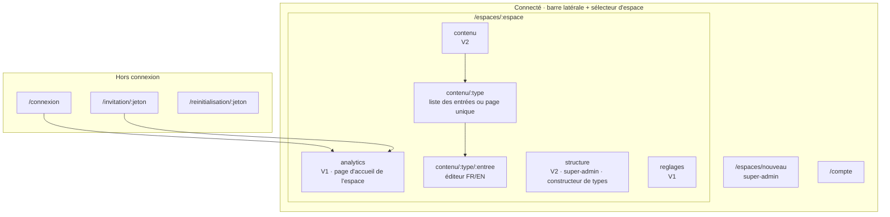
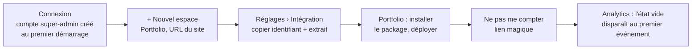
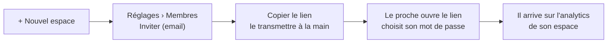
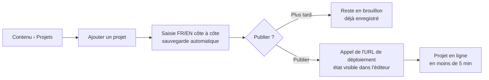
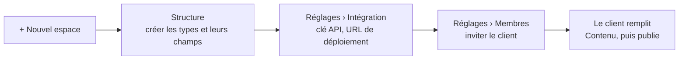

# Architecture de contenu et UX — dashboard de Dashility

4 novembre 2026, complété le 6 novembre 2026 pour la V2 · s'appuie sur `01-PRD.md` et `decisions.md`

Ce document organise les écrans et les parcours du dashboard. Les écrans V1 et V2 sont détaillés (wireframes et états), ainsi que la publication programmée de la V3 ; le reste de la V3 n'est décrit qu'en arborescence et en parcours.

Méthode allégée : pas de territoire de marque ni de DA. Le dashboard est neutre et construit avec shadcn-vue (PRD, « Exigences de qualité »).

## Principes

- **Interface en français uniquement.** Le contenu géré est en FR et en EN, mais le dashboard lui-même ne parle que français.
- **Un espace à la fois.** Toute la navigation se fait dans le contexte d'un espace, choisi avec le sélecteur d'espace. Un membre peut appartenir à plusieurs espaces.
- **On arrive là où on s'était arrêté.** Après la connexion : l'analytics du dernier espace ouvert (le seul espace pour un membre qui n'en a qu'un).
- **Pas d'email en V1.** Les liens d'invitation et de réinitialisation s'affichent dans le dashboard ; le super-admin les copie et les transmet à la main.
- **Un espace interdit n'existe pas.** Un membre qui ouvre l'URL d'un espace dont il n'est pas membre reçoit une page 404, pas une 403, pour ne pas révéler son existence.
- **Utilisable sur mobile.** L'analytics doit pouvoir se consulter sur téléphone : la barre latérale devient un tiroir sous 768 px.

## Arborescence



### URLs

| URL | Qui | Version |
| --- | --- | --- |
| `/connexion` | Tous | V1 |
| `/invitation/:jeton` | Invité | V1 |
| `/reinitialisation/:jeton` | Membre ou super-admin | V1 |
| `/espaces/nouveau` | Super-admin | V1 |
| `/espaces/:espace/analytics` | Membres de l'espace | V1 |
| `/espaces/:espace/reglages` | Membres de l'espace (sections réduites pour un membre) | V1 |
| `/compte` | Tous | V1 |
| `/espaces/:espace/contenu`, `…/contenu/:type`, `…/contenu/:type/:entree` | Membres de l'espace | V2 |
| `/espaces/:espace/structure` | Super-admin | V2 |

`:espace` est le slug de l'espace (ex. `portfolio`).

## Mise en page commune (connecté)

```
┌──────────────────┬─────────────────────────────────────────────┐
│ [Portfolio    ▾] │  Analytics                                   │
│                  │                                              │
│  Analytics       │  (contenu de l'écran)                        │
│  Contenu    V2   │                                              │
│  Structure  V2 ★ │                                              │
│                  │                                              │
│  Réglages        │                                              │
│                  │                                              │
│ ──────────────── │                                              │
│  Costa M.     ▾  │                                              │
│   Mon compte     │                                              │
│   Déconnexion    │                                              │
└──────────────────┴─────────────────────────────────────────────┘
★ visible par le super-admin uniquement
```

- **Sélecteur d'espace** : liste des espaces du compte, recherche si plus de 5 espaces, et une entrée « + Nouvel espace » pour le super-admin. Si le compte n'a qu'un espace, le sélecteur devient un simple titre.
- Lien d'évitement « Aller au contenu » en premier élément focusable.
- Titre de l'onglet du navigateur : `<Écran> · <Espace> · Dashility`.

## Écrans V1

### Connexion

```
┌──────────────────────────────┐
│ Connexion                    │
│ Email        [____________]  │
│ Mot de passe [____________]  │
│ [ Se connecter ]             │
│                              │
│ Mot de passe oublié ?        │
│ Demandez un lien de          │
│ réinitialisation à votre     │
│ administrateur.              │
└──────────────────────────────┘
```

- Erreur d'identifiants : un message unique (« Email ou mot de passe incorrect »), sans dire lequel des deux est faux.
- Trop de tentatives : message « Trop de tentatives, réessayez dans quelques minutes ».
- Session expirée sur un écran connecté : retour à `/connexion`, puis retour à l'écran d'origine après la connexion.

### Invitation et réinitialisation

Les deux écrans ont la même forme : l'email est affiché en lecture seule, avec deux champs « Nouveau mot de passe » et « Confirmer ».

- **Invitation acceptée** : le compte est créé, l'utilisateur est connecté et arrive sur l'analytics de l'espace.
- **Réinitialisation réussie** : l'utilisateur est connecté et arrive sur son dernier espace ouvert.
- **Jeton expiré ou déjà utilisé** : la page dit « Ce lien n'est plus valide, demandez-en un nouveau à votre administrateur », sans formulaire.
- **Durées de validité proposées** : 72 h pour une invitation, transmise à la main, donc parfois lue tard ; 24 h pour une réinitialisation.

### Analytics (page d'accueil d'un espace)

```
┌ Période [30 derniers jours ▾]                  [Exporter en CSV] ┐
│ ┌── Vues ──┐ ┌─ CV téléchargés ┐ ┌─ Taux ─┐  ┌ Temps réel ───⏸┐ │
│ │  1 240   │ │       38        │ │ 3,1 %  │  │ 12 vues / 30 min│ │
│ └──────────┘ └─────────────────┘ └────────┘  │ 14:02 Vue       │ │
│ ┌ Vues et CV par jour ─────────────────────┐ │   /projets/cms  │ │
│ │  ╱╲__╱╲___╱╲          [Voir en tableau]  │ │ 14:01 CV        │ │
│ └──────────────────────────────────────────┘ │   /projets/api  │ │
│                                              └─────────────────┘ │
│ ┌ Pages ──────────── Vues  CV  Taux ┐ ┌ Provenances ─── Vues ┐   │
│ │ /projets/cms        320   14  4,4% │ │ LinkedIn     508 41% │   │
│ │ /                   610    9  1,5% │ │ Accès direct 372 30% │   │
│ │ …                                  │ │ …                    │   │
│ └────────────────────────────────────┘ └──────────────────────┘   │
└──────────────────────────────────────────────────────────────────┘
```

- **Période** : 7 derniers jours, 30 derniers jours (valeur par défaut), 6 mois, ou personnalisée. Le calendrier ne propose que les 6 derniers mois, puisque rien n'est conservé au-delà.
- **Tuiles** : vues, CV téléchargés, taux de conversion (CV ÷ vues) sur la période.
- **Courbe** : vues et téléchargements par jour. Le bouton « Voir en tableau » affiche les mêmes données en tableau, comme alternative accessible.
- **Pages** : vues, téléchargements du CV et taux par page, triables, avec les vues décroissantes par défaut.
- **Provenances** : site d'origine regroupé (LinkedIn, GitHub, Google, Accès direct, sinon le nom de domaine), avec les vues et leur part.
- **Temps réel** : nombre de vues des 30 dernières minutes et flux des 20 derniers événements. Comme il n'existe pas d'identifiant de visiteur, on affiche des **événements**, jamais des « visiteurs actifs ». Un bouton pause arrête la mise à jour automatique (WCAG 2.2.2), et le flux n'est pas annoncé par les lecteurs d'écran pour ne pas les saturer.
- **Export CSV** : les événements bruts de la période, une ligne par événement (`date, type, page, provenance`).

**États**

| État | Affichage |
| --- | --- |
| Chargement | Squelettes à la place des tuiles, de la courbe et des tableaux |
| Aucun événement jamais reçu | Message « Aucune donnée pour l'instant » et lien vers Réglages › Intégration pour installer le script |
| Période sans données | Tuiles à 0, et message « Aucune visite sur cette période » à la place de la courbe et des tableaux |
| Erreur de chargement | Message et bouton « Réessayer » ; les autres blocs restent affichés |
| Temps réel interrompu | Pastille « Reconnexion… » dans l'encart ; reconnexion automatique |
| Premier événement reçu | L'état vide est remplacé sans recharger la page |

### Réglages d'un espace

Une seule page, en sections. Un membre ne voit que la section « Ne pas me compter ».

```
Réglages
├─ Général ★            Nom, slug, URL du site          [Enregistrer]
├─ Membres ★            Liste : email, statut (actif, invité), actions
│                       [Inviter un membre]
├─ Intégration ★        Identifiant public de l'espace  [Copier]
│                       Extrait d'installation du package [Copier]
├─ Ne pas me compter    [Ouvrir le site et m'exclure]
│                       [Ouvrir le site et me compter à nouveau]
└─ Zone de danger ★     [Supprimer l'espace]
★ super-admin uniquement
```

**Membres**

- **Inviter** : champ email, puis génération d'un lien à usage unique affiché avec un bouton « Copier ». Le membre apparaît « invité » jusqu'à ce qu'il accepte.
- **Email qui a déjà un compte** : il est ajouté directement à l'espace, sans lien, puisqu'il peut se connecter avec ses identifiants actuels.
- **Actions par membre** : générer un lien de réinitialisation, retirer de l'espace, régénérer ou annuler une invitation en attente.
- **Super-admin** : il n'apparaît pas dans la liste et ne peut pas être retiré.

**Ne pas me compter (lien magique)**

Le dashboard ne peut pas écrire dans le stockage d'un site qui n'est pas sur son domaine. Le bouton ouvre donc le site dans un nouvel onglet avec le paramètre `?dashility-ignore=1`. Le script de collecte lit ce paramètre, enregistre le marqueur dans le `localStorage` du site, retire le paramètre de l'URL et affiche une courte confirmation (« Vos visites ne sont plus comptées sur ce navigateur »). `?dashility-ignore=0` annule l'exclusion. L'opération se fait une fois par navigateur et par site.

N'importe qui peut ajouter ce paramètre à l'URL, mais il ne peut exclure que lui-même : il n'y a donc aucun risque.

**Supprimer l'espace** : il faut retaper le nom de l'espace pour confirmer. Les membres qui n'appartiennent à aucun autre espace perdent l'accès.

### Nouvel espace

Champs : nom, slug (pré-rempli depuis le nom), URL du site. Après la création, on arrive sur Réglages › Intégration pour installer le script.

### Mon compte

- Email (lecture seule en V1).
- Changer le mot de passe : mot de passe actuel, nouveau mot de passe, confirmation.

## Écrans V2

La V2 ajoute le contenu. Le super-admin définit des **types** dans Structure ; les membres remplissent des **entrées** dans Contenu.

### Principes de la V2

- **Le site ne montre jamais un texte à moitié écrit.** La saisie est sauvegardée automatiquement, mais elle reste un brouillon tant qu'on n'a pas cliqué sur « Publier ». Sur une entrée déjà publiée, les modifications sont gardées à part et le site garde l'ancienne version jusqu'à « Publier les modifications ».
- **FR et EN côte à côte, champ par champ.** Chaque champ traduisible a sa colonne FR et sa colonne EN sur la même ligne : on traduit en regardant l'original. Un champ non traduisible occupe toute la largeur, une seule fois. Un sélecteur « Côte à côte · Français · English » en haut de l'éditeur permet aussi de n'afficher qu'une langue, sur toute la largeur, pour avoir la place d'écrire ; il bascule tous les champs à la fois.
- **Le français est la langue de référence.** Publier exige les champs obligatoires en français. Une version anglaise incomplète n'empêche pas de publier : l'entrée est masquée sur le site en anglais (PRD, « Langues ») et le dashboard le signale partout où elle apparaît.
- **Pas de médiathèque.** Une image s'envoie directement dans son champ, avec ses textes alternatifs.
- **Les fichiers sont des champs.** Le CV n'a pas d'écran à lui : c'est une page unique « CV » avec un champ « Fichier PDF » traduisible, donc un fichier FR et un fichier EN. Un espace sans CV n'a pas d'écran inutile.

### Statuts d'une entrée

| Statut | Badge dans les listes | Ce que voit le site |
| --- | --- | --- |
| Brouillon | « Brouillon » | Rien |
| Publié | « Publié » | La version publiée |
| Publié, avec des modifications en attente | « Publié » + « Modifications non publiées » | La version publiée, sans les modifications |

Le badge « EN incomplet » s'ajoute quand un champ obligatoire traduisible n'a pas sa valeur anglaise (texte alternatif d'une image compris).

### Contenu

```
Contenu
┌ Projets ─────────── collection ┐ ┌ Parcours ────────── collection ┐
│ 4 publiés · 1 brouillon        │ │ 9 publiés                      │
│ 1 EN incomplet                 │ │                                │
└────────────────────────────────┘ └────────────────────────────────┘
┌ Qui je suis ──── page unique ──┐ ┌ CV ──────────── page unique ───┐
│ Publié                         │ │ Publié · EN incomplet          │
└────────────────────────────────┘ └────────────────────────────────┘
```

- Une carte par type, dans l'ordre de Structure. Une collection ouvre la liste de ses entrées ; une page unique ouvre directement l'éditeur.
- Les types apparaissent aussi sous « Contenu » dans la barre latérale, pour y aller en un clic.

| État | Affichage |
| --- | --- |
| Aucun type (super-admin) | « Cet espace n'a pas encore de type de contenu » et bouton « Créer un type » vers Structure |
| Aucun type (membre) | « Le contenu de cet espace n'est pas encore prêt. Votre administrateur doit d'abord le configurer. » |
| Chargement | Squelettes des cartes |
| Erreur | Message et bouton « Réessayer » |

### Liste des entrées d'une collection

```
Projets                                              [+ Ajouter un projet]
┌───────────────────────────────┬──────────────────────────┬────────────┐
│ Titre                         │ Statut                   │ Modifié    │
├───────────────────────────────┼──────────────────────────┼────────────┤
│ Dashility                     │ Brouillon · EN incomplet │ il y a 2 h │
│ Ce portfolio                  │ Publié · Modifs non pub. │ hier       │
│ API de réservation            │ Publié                   │ 12 oct.    │
└───────────────────────────────┴──────────────────────────┴────────────┘
```

- **Titre** : la valeur française du premier champ « texte court » du type, ou « Sans titre ».
- **Tri** : dernière modification d'abord. L'ordre sur le site est décidé par le site (PRD), pas par cette liste.
- **Filtre** par statut (Tous, Brouillons, Publiés, EN incomplet) au-dessus du tableau. Pas de recherche en V2 : un portfolio compte quelques dizaines d'entrées.
- Sur mobile, le tableau devient une liste de cartes (titre, badges, date).

| État | Affichage |
| --- | --- |
| Aucune entrée | « Aucun projet pour l'instant » et le bouton « Ajouter un projet » |
| Filtre sans résultat | « Aucune entrée ne correspond à ce filtre » et lien « Tout afficher » |

### Éditeur d'entrée

```
← Projets
Ce portfolio                       Publié · Modifications non publiées
Enregistré à 14:02                 [Annuler les modifications] [Publier les modifications] [⋯]
Dernier déploiement : demandé à 13:40 · réussi
──────────────────────────────────────────────────────────────────────
Identifiant d'URL   [ce-portfolio          ]   /projets/ce-portfolio
──────────────────────────────────────────────────────────────────────
                          Français                 English
Titre *                   [Ce portfolio      ]     [This portfolio    ]
Accroche *                [Ce site, de la …  ]     [This site, from … ]
Type de projet *          [Projet perso ▾]  (libellé EN affiché automatiquement)
Durée *                   [10/2026] → [     ]  ☑ en cours
Stack                     [Vue 3 ×] [TypeScript ×] [Vite ×] [+ ajouter]
Image principale *        ┌──────────┐ Texte alternatif FR […]   EN […]
                          │  aperçu  │ [Remplacer] [Retirer]
                          └──────────┘
Contexte                  ┌ B I 🔗 • 1. H ✦ ┐     ┌ B I 🔗 • 1. H ✦ ┐
                          │ Étudiant …      │     │ Engineering …    │
                          └─────────────────┘     └──────────────────┘
Contraintes               ┌ 1 ─────────────────────────────── ↑ ↓ 🗑 ┐
                          │ Titre       [Budget : 0 €]  [Budget: €0] │
                          │ Description [Aucun …     ]  [No paid … ] │
                          └──────────────────────────────────────────┘
                          [+ Ajouter une contrainte]
```

**En-tête**

- Retour à la liste, titre de l'entrée, badge de statut, état de la sauvegarde et état du dernier déploiement.
- **Actions selon le statut** :

| Statut | Bouton principal | Autres actions (menu ⋯) |
| --- | --- | --- |
| Brouillon | « Publier » | Supprimer |
| Publié | aucun | Dépublier, Supprimer |
| Publié, avec des modifications en attente | « Publier les modifications » et « Annuler les modifications » | Dépublier, Supprimer |

- « Annuler les modifications » revient à la version publiée, après confirmation.
- « Dépublier » repasse l'entrée en brouillon et la retire du site au prochain déploiement.
- « Supprimer » demande une confirmation ; c'est définitif (pas d'historique, PRD). Une page unique ne se supprime pas.
- Le choix « Brouillon » du scénario du PRD est implicite : tant qu'on ne publie pas, l'entrée reste en brouillon, déjà enregistré.

**Sauvegarde automatique**

- Une seconde après la dernière frappe, et quand on quitte un champ.
- Indicateur dans l'en-tête : « Enregistrement… », « Enregistré à 14:02 », ou « Non enregistré » avec « Réessayer ». En cas d'échec, l'éditeur réessaie tout seul et prévient avant de quitter la page tant que la saisie n'est pas enregistrée.
- **Modification ailleurs** : si l'entrée a été modifiée dans un autre onglet ou par un autre membre depuis son ouverture, la sauvegarde s'arrête et un bandeau propose « Recharger la dernière version ». Rien n'est écrasé sans le savoir.

**Publier**

- Les champs obligatoires en français sont vérifiés. S'il en manque, la publication est refusée, chaque champ fautif est signalé et le focus va sur le premier.
- Si la version anglaise est incomplète, une confirmation prévient : « La version anglaise est incomplète : cette entrée sera masquée sur le site en anglais. Publier quand même ? »
- Une erreur de format (lien invalide, nombre mal écrit) est signalée sur le champ dès la saisie. Elle n'empêche pas d'enregistrer le brouillon, mais elle empêche de publier.

**Déploiement**

Publier, publier des modifications, dépublier ou supprimer une entrée publiée appelle l'URL de déploiement de l'espace. L'en-tête affiche l'état de cet appel, pas celui du site : le CMS ne sait pas quand le site a fini sa mise en ligne.

| État | Affichage |
| --- | --- |
| Pas d'URL de déploiement | « Aucun déploiement configuré » ; lien vers Réglages › Intégration pour le super-admin |
| Appel en cours | « Déploiement demandé… » |
| Appel réussi | « Déploiement demandé à 14:02 · réussi » |
| Appel en échec | « Le déploiement a échoué (le site a répondu 500) » et bouton « Relancer » |

**Identifiant d'URL** (collections uniquement)

- Pré-rempli depuis le titre français tant que l'entrée n'a jamais été publiée, puis figé. Le modifier ensuite reste possible, avec un avertissement : les liens déjà partagés vers l'ancienne adresse ne marcheront plus.
- Il est unique dans le type ; un doublon est signalé sur le champ.

**Sur mobile** (moins de 768 px) : les deux colonnes ne tiennent pas, le sélecteur se réduit à « Français · English ».

**Accessibilité**

- Chaque champ a son libellé, avec la langue : « Titre (français) », « Titre (anglais) ». Les champs EN portent `lang="en"`.
- Les éléments d'un groupe répétable se déplacent avec les boutons ↑ et ↓, pas seulement au glisser-déposer.
- Les messages de sauvegarde ne sont pas annoncés à chaque frappe : seuls « Non enregistré », « Publié » et les erreurs le sont.

### Les types de champs

| Champ | Saisie | Réglages dans Structure |
| --- | --- | --- |
| Texte court | Champ d'une ligne | Longueur maximale (facultatif) |
| Texte riche | Éditeur visuel : gras, italique, lien, liste à puces, liste numérotée, intertitre, mise en avant (✦, le surlignage du portfolio). Coller depuis un traitement de texte ne garde que ces mises en forme | — |
| Liste de choix | Liste déroulante | Les choix, chacun avec un libellé FR et EN ; on choisit une seule fois, le libellé anglais suit |
| Date ou période | Mois et année (ou jour, mois, année) ; pour une période, un début, une fin et une case « en cours » | Date seule ou période ; précision au jour ou au mois |
| Lien | Champ d'adresse, vérifié (`https://…`) | — |
| Liste de valeurs | Étiquettes : Entrée pour ajouter, × pour retirer, réordonnables | — |
| Nombre | Champ numérique | Décimales autorisées ou non |
| Oui / non | Interrupteur | Valeur par défaut |
| Image | Glisser-déposer ou « Parcourir », aperçu, textes alternatifs FR et EN obligatoires, « Remplacer » et « Retirer ». JPEG, PNG ou WebP, 10 Mo au plus | — |
| Fichier PDF | « Parcourir », nom, taille et date du fichier, « Remplacer » (après confirmation, sans historique) et « Télécharger ». 10 Mo au plus | — |
| Groupe répétable | Cartes numérotées, repliées à l'ouverture de l'entrée ; l'en-tête montre le numéro et le premier texte court (« Contraintes 1 · Budget. ») et déplie la carte au clic. Un élément ajouté, ou qui a une erreur de publication, s'ouvre. « Ajouter », ↑ ↓ et suppression | Les sous-champs (tous les types sauf un autre groupe) ; nombre minimal et maximal d'éléments (facultatifs) |

Tous les champs se règlent aussi en **obligatoire ou facultatif**, et en **traduisible ou non** (sauf le groupe : ce sont ses sous-champs qui sont traduisibles). Dans un groupe, les éléments sont les mêmes en FR et en EN : on ajoute une contrainte une fois, puis on remplit ses deux langues.

« Oui / non » et « Fichier PDF » s'ajoutent à la liste du PRD : le premier pour « à la une » du portfolio, le second pour le CV.

### Structure (super-admin)

```
Structure                                                   [+ Nouveau type]
┌ Types ─────────────┐ ┌ Projets ──────────────────────────────────────────┐
│ ▸ Projets          │ │ Nom au pluriel  [Projets     ]                    │
│   Parcours         │ │ Une entrée      [un projet   ]  → « Ajouter un projet »
│   Compétences      │ │ Identifiant     projets (figé)   Nature : collection
│   Qui je suis      │ │                                                   │
│   CV               │ │ Champs                                            │
└────────────────────┘ │ ┌ Titre ─── texte court · obligatoire · trad. ↑↓ ⋯┐
                       │ ├ Accroche ─ texte court · obligatoire · trad. ↑↓ ⋯┤
                       │ ├ Contraintes ─ groupe répétable (2 champs)   ↑↓ ⋯┤
                       │ └──────────────────────────────────────────────────┘
                       │ [+ Ajouter un champ]                               │
                       │                         [Annuler] [Enregistrer le type]
                       └───────────────────────────────────────────────────┘
```

- **Nouveau type** : nom au pluriel, nom d'une entrée avec son article (« un projet », « une expérience », pour le bouton « Ajouter un projet »), identifiant (généré depuis le nom, modifiable à la création) et nature (collection ou page unique).
- **Ajouter un champ** : choix du type de champ, libellé, identifiant (généré depuis le libellé), obligatoire, traduisible, puis les réglages propres au type.
- **Ce qui est figé après la création**, parce que les entrées et les sites en dépendent : l'identifiant et la nature d'un type ; l'identifiant, le type et le caractère traduisible d'un champ. Pour les changer, on supprime et on recrée.
- **Ce qui reste modifiable** : noms, libellés, ordre des champs, obligatoire ou facultatif (la règle s'applique à la prochaine publication), choix d'une liste. L'identifiant d'un choix enregistré est figé ; retirer un choix utilisé efface sa valeur des entrées, après la même confirmation qu'un champ supprimé.
- **Supprimer un champ ou un type** utilisé par des entrées : la confirmation donne le nombre d'entrées touchées (« Les valeurs de ce champ seront supprimées dans 4 projets ») ; pour un type, il faut retaper son nom.
- **Enregistrement explicite**, pas automatique : une structure se modifie rarement, et certaines modifications sont destructives. Quitter avec des changements non enregistrés demande une confirmation.
- Écran pensé pour un ordinateur ; il reste utilisable sur mobile, en une colonne.

| État | Affichage |
| --- | --- |
| Aucun type | « Commencez par créer un type : une collection (projets, articles) ou une page unique (accueil, à propos) » et bouton « Nouveau type » |
| Type sans champ | « Ajoutez au moins un champ » ; le type n'apparaît pas dans Contenu tant qu'il n'a aucun champ |
| Identifiant déjà pris | Erreur sur le champ |

### Réglages › Intégration (ajouts V2)

```
Intégration ★
├─ Identifiant public (analytics)        [Copier]                    V1
├─ Clé API de lecture                    [Générer une clé]           V2
│    Créée le 6 nov. 2026                [Régénérer]
├─ URL de déploiement   [https://…                  ] [Enregistrer]  V2
│    Dernier appel : 14:02 · réussi      [Lancer un déploiement]
└─ Extraits d'installation               [Copier]
```

- **Clé API** : affichée **une seule fois**, juste après sa génération, avec « Copier » et l'avertissement « Elle ne sera plus affichée ». Ensuite, seule sa date de création apparaît. « Régénérer » demande une confirmation : l'ancienne clé cesse aussitôt de fonctionner, et le site devra utiliser la nouvelle.
- **URL de déploiement** : l'adresse appelée à chaque publication (un hook de build, ou rien pour un site qui lit l'API à chaque visite). « Lancer un déploiement » l'appelle tout de suite, pour tester.

## Les types du portfolio (test d'acceptation de la V2)

La V2 est acceptée quand le super-admin peut créer ces types dans Structure, sans code, et que le portfolio peut en afficher le contenu. Les libellés courts de l'interface du site (menus, boutons) restent dans son code.

**Projets** (collection, « un projet »). Le type « Projet » du PRD, complété par ce que le site utilise aujourd'hui :

| Champ | Type de champ | Obl. | Trad. |
| --- | --- | --- | --- |
| Type de projet | Liste de choix : perso, école, entreprise, client | oui | — |
| Titre | Texte court | oui | oui |
| Accroche | Texte court | oui | oui |
| Lien vers le code, lien vers la démo | Lien | non | non |
| Pourquoi le code n'est pas public | Texte court | non | oui |
| Rôle, équipe | Texte court | oui | oui |
| Durée | Période (au mois, avec « en cours ») ; le site trie les projets dessus | oui | — |
| Stack | Liste de valeurs | oui | non |
| À la une | Oui / non (remplacé par la mise en avant automatique en V3) | — | — |
| Image principale | Image | oui | alt. oui |
| Cadre de la capture | Liste de choix : navigateur, téléphone | oui | — |
| Contexte, Besoin | Texte court (accroche) + texte riche | oui | oui |
| Contraintes, Enseignements | Groupe répétable : titre (texte court), description (texte riche) | non | oui |
| Méthode | Texte court (intro) + groupe répétable : titre, description | non | oui |
| Choix techniques | Groupe répétable : titre, description, compromis | non | oui |
| Résultats | Groupe répétable : valeur (texte court), libellé (texte court), avant et après (nombres, facultatifs) ; puis conclusion (texte riche) | non | oui, sauf les nombres |

**Parcours** (collection, « une étape ») : étiquette (liste de choix : lycée, école, échange, stage, job étudiant), période, titre, lieu, texte (texte court), étude de cas liée (texte court : l'identifiant d'URL d'un projet, facultatif). Le site trie les étapes sur la période.

**Compétences** (page unique) : un groupe répétable « Catégories » avec un titre (traduisible) et des compétences (liste de valeurs, non traduisible). La mise en avant des technos utilisées par le site lui-même reste dans le code du portfolio : elle décrit son code, pas son contenu.

**Qui je suis, Mon histoire, Mentions légales, Confidentialité** (pages uniques) : un champ texte riche traduisible, obligatoire.

**Coordonnées** (page unique) : email (texte court), LinkedIn, GitHub, dépôt du site (liens), non traduisibles.

**CV** (page unique) : un champ « Fichier PDF » traduisible et obligatoire.

## V3 : publication programmée

On choisit le jour et l'heure où une entrée part en ligne : un projet relu le vendredi est publié le lundi à 9 h.

### Principes

- **On programme une version relue.** La programmation fige l'entrée telle qu'elle est : c'est cette version qui part en ligne, jamais une phrase en cours d'écriture (principe de la V2).
- **Modifier l'entrée annule la programmation.** Pendant une programmation, les champs sont en lecture seule. Le bouton « Modifier l'entrée » annule la programmation, après confirmation, et rend les champs modifiables. Une modification venue d'ailleurs (un autre membre, un changement de structure) l'annule aussi, et l'éditeur dit pourquoi.
- **On ne programme que la publication.** « Publier » pour un brouillon, « Publier les modifications » pour une entrée en ligne. Dépublier reste immédiat.
- **À la minute, à l'heure de Paris.** L'entrée est publiée dans la minute qui suit l'heure choisie, puis le déploiement est demandé comme pour une publication manuelle.
- **Mêmes droits et mêmes contrôles que « Publier ».** Tout membre de l'espace peut programmer. Les champs obligatoires en français et les formats sont vérifiés au moment de programmer ; une version anglaise incomplète demande la même confirmation.

### Statut et badge

| Situation | Badge dans les listes | Ce que voit le site |
| --- | --- | --- |
| Brouillon programmé | « Brouillon » + « Programmé le 17 nov. à 9:00 » | Rien, jusqu'à l'heure prévue |
| Publié, modifications programmées | « Publié » + « Programmé le 17 nov. à 9:00 » | La version publiée, jusqu'à l'heure prévue |

- **Liste des entrées** : filtre « Programmées » en plus des autres.
- **Contenu** : la carte d'un type compte ses entrées programmées (« 1 programmé »).

### Programmer, dans l'éditeur

```
Ce portfolio                                    Brouillon
Enregistré à 14:02                [Publier] [Programmer…] [⋯]

          ┌ Programmer la publication ─────────────────────┐
          │ Date   [17/11/2026]   Heure  [09:00]  heure de Paris │
          │                       [Annuler] [Programmer]    │
          └─────────────────────────────────────────────────┘
```

- **« Programmer… »** est à côté de « Publier » (ou de « Publier les modifications »). Il ouvre un panneau sous l'en-tête : date et heure, avec l'indication « heure de Paris ». La date proposée est demain à 9:00.
- **Bornes** : au moins une minute dans le futur, au plus un an. Une heure passée est refusée sur le champ (« Choisissez une date à venir »).
- **« Programmer »** enregistre d'abord la saisie en cours, puis fait les contrôles de « Publier ». S'il manque des champs, la programmation est refusée et les champs fautifs sont signalés, comme pour une publication.

### Pendant la programmation

```
Ce portfolio                          Brouillon · Programmé
┌──────────────────────────────────────────────────────────────┐
│ ⏱ Publication programmée le lundi 17 novembre à 9:00          │
│   (heure de Paris). Les champs sont en lecture seule.        │
│   [Changer la date] [Annuler la programmation] [Modifier l'entrée] │
└──────────────────────────────────────────────────────────────┘
Titre *        [Ce portfolio      ] (lecture seule)
```

- **Changer la date** : rouvre le panneau, avec la date actuelle.
- **Annuler la programmation** : l'entrée reste dans son état (brouillon, ou publiée avec ses modifications en attente). Pas de confirmation : rien n'est perdu.
- **Modifier l'entrée** : confirmation (« Modifier l'entrée annule la publication programmée. Continuer ? »), puis les champs redeviennent modifiables.
- **Publier tout de suite** reste possible : « Publier » publie maintenant et retire la programmation.
- Les champs en lecture seule restent lisibles et sélectionnables (pas grisés au point d'être illisibles), et annoncés comme tels aux lecteurs d'écran.

### Après l'heure prévue

| État | Affichage dans l'éditeur |
| --- | --- |
| Publiée | Le badge « Programmé » disparaît ; message « Publiée le 17 nov. à 9:00, comme prévu » jusqu'au prochain enregistrement. L'état du déploiement s'affiche comme d'habitude |
| Serveur arrêté à l'heure prévue | L'entrée est publiée dès son redémarrage ; le message donne l'heure réelle (« Publiée le 17 nov. à 9:12, au lieu de 9:00 ») |
| Programmation annulée par une modification venue d'ailleurs | Bandeau « La publication programmée du 17 nov. à 9:00 a été annulée : l'entrée a été modifiée (par un membre ou par un changement de structure). » et le bouton « Programmer à nouveau » |
| Publication refusée à l'heure prévue (cas rare : une règle a changé depuis) | Bandeau d'erreur « La publication programmée du 17 nov. à 9:00 a échoué : … », les champs fautifs signalés ; l'entrée reste dans son état |

## Parcours utilisateurs

### 1. Toi, premier lancement : brancher le portfolio (V1)



### 2. Toi, au quotidien : voir quels projets font de l'effet (V1)

Connexion, arrivée sur l'analytics du portfolio, choix de la période, tri du tableau Pages par taux, puis export CSV si besoin.

### 3. Toi : ouvrir un espace à un proche (V1)



### 4. Un membre a oublié son mot de passe (V1)

La page de connexion lui dit de contacter l'administrateur. Toi, dans Réglages › Membres, tu génères un lien de réinitialisation et tu le transmets. Le membre choisit un nouveau mot de passe et arrive sur son dernier espace ouvert.

### 5. Toi : ajouter un projet sans ouvrir l'éditeur de code (V2, scénario cible du PRD)



### 6. Toi : préparer un nouvel espace pour un client (V2)



### 7. Un membre corrige un projet déjà en ligne (V2)

Il ouvre le projet depuis Contenu › Projets et corrige une phrase : la correction est enregistrée, l'entrée affiche « Modifications non publiées », et le site garde l'ancienne version. Il clique sur « Publier les modifications » ; le déploiement est demandé et son état s'affiche dans l'en-tête. S'il change d'avis avant de publier, « Annuler les modifications » le ramène à la version en ligne.

### 8. Toi : publier un projet lundi à 9 h (V3)

Le vendredi, tu termines le projet, puis « Programmer… » : lundi, 9:00. Les contrôles passent, l'entrée affiche « Programmé le 17 nov. à 9:00 » et ses champs passent en lecture seule. Le lundi à 9:00, elle est publiée et le déploiement est demandé ; le site est à jour quelques minutes plus tard. Si tu avais voulu corriger une faute entre-temps, « Modifier l'entrée » aurait annulé la programmation : il aurait fallu la relancer après la correction.

## V3 et au-delà : ce qui s'ajoute

| Écran | Rôle | Version |
| --- | --- | --- |
| Éditeur d'entrée | Bouton « Prévisualiser » (la publication programmée est détaillée plus haut) | V3 |
| Analytics | Classement des projets par score et projets mis en avant | V3 |
| Connexion et Mon compte | Double authentification TOTP : étape de code à la connexion, activation dans Mon compte, désactivation par le super-admin si un membre perd son téléphone | Après la V1 |

## Questions reportées

À trancher dans l'architecture technique de la V2 :

- Format de stockage du texte riche (HTML restreint ou structure JSON) et bibliothèque de l'éditeur visuel.
- Images : dossier sur le NAS, variantes générées, et ce qui se passe si le NAS est injoignable ; seconde copie selon le NAS (RAID ou non).
- Forme de l'API publique de lecture (routes, filtre par langue, entrées masquées en anglais) et extrait d'installation correspondant.
- Regroupement des appels de déploiement quand plusieurs publications se suivent de près.
- Migration du contenu actuel du portfolio (Markdown et TypeScript) vers ces types.
