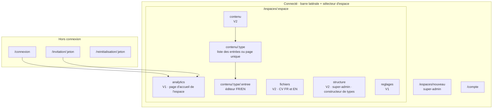
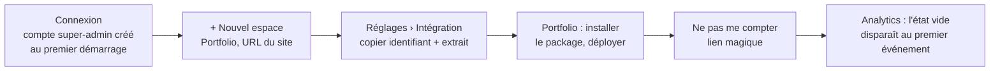
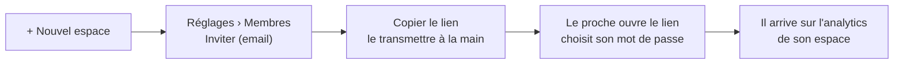
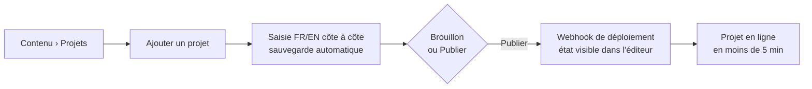

# Architecture de contenu et UX — dashboard du CMS

4 novembre 2026 · s'appuie sur `01-PRD.md` et `decisions.md`

Ce document organise les écrans et les parcours du dashboard. Les écrans V1 sont détaillés (wireframes et états) ; la V2 et la V3 ne sont décrites qu'en arborescence et en parcours, leurs wireframes seront faits au début de la V2.

Méthode allégée : pas de territoire de marque ni de DA. Le dashboard est neutre et construit avec shadcn-vue (PRD, « Exigences de qualité »).

## Principes

- **Interface en français uniquement.** Le contenu géré est en FR et en EN, mais le dashboard lui-même ne parle que français.
- **Un espace à la fois.** Toute la navigation se fait dans le contexte d'un espace, choisi avec le sélecteur d'espace. Un membre peut appartenir à plusieurs espaces.
- **On arrive là où on s'était arrêté.** Après la connexion : l'analytics du dernier espace ouvert (le seul espace pour un membre qui n'en a qu'un).
- **Pas d'email en V1.** Les liens d'invitation et de réinitialisation s'affichent dans le dashboard ; le super-admin les copie et les transmet à la main.
- **Un espace interdit n'existe pas.** Un membre qui ouvre l'URL d'un espace dont il n'est pas membre reçoit une page 404, pas une 403, pour ne pas révéler son existence.
- **Utilisable sur mobile.** L'analytics doit pouvoir se consulter sur téléphone : la barre latérale devient un tiroir sous 768 px.

## Arborescence



### URLs

| URL | Qui | Version |
| --- | --- | --- |
| `/connexion` | Tous | V1 |
| `/invitation/:jeton` | Invité | V1 |
| `/reinitialisation/:jeton` | Membre ou super-admin | V1 |
| `/espaces/nouveau` | Super-admin | V1 |
| `/espaces/:espace/analytics` | Membres de l'espace | V1 |
| `/espaces/:espace/reglages` | Membres de l'espace (sections réduites pour un membre) | V1 |
| `/compte` | Tous | V1 |
| `/espaces/:espace/contenu`, `…/contenu/:type`, `…/contenu/:type/:entree` | Membres de l'espace | V2 |
| `/espaces/:espace/fichiers` | Membres de l'espace | V2 |
| `/espaces/:espace/structure` | Super-admin | V2 |

`:espace` est le slug de l'espace (ex. `portfolio`).

## Mise en page commune (connecté)

```
┌──────────────────┬─────────────────────────────────────────────┐
│ [Portfolio    ▾] │  Analytics                                   │
│                  │                                              │
│  Analytics       │  (contenu de l'écran)                        │
│  Contenu    V2   │                                              │
│  Fichiers   V2   │                                              │
│  Structure  V2 ★ │                                              │
│  Réglages        │                                              │
│                  │                                              │
│ ──────────────── │                                              │
│  Costa M.     ▾  │                                              │
│   Mon compte     │                                              │
│   Déconnexion    │                                              │
└──────────────────┴─────────────────────────────────────────────┘
★ visible par le super-admin uniquement
```

- **Sélecteur d'espace** : liste des espaces du compte, recherche si plus de 5 espaces, et une entrée « + Nouvel espace » pour le super-admin. Si le compte n'a qu'un espace, le sélecteur devient un simple titre.
- Lien d'évitement « Aller au contenu » en premier élément focusable.
- Titre de l'onglet du navigateur : `<Écran> · <Espace> · CMS`.

## Écrans V1

### Connexion

```
┌──────────────────────────────┐
│ Connexion                    │
│ Email        [____________]  │
│ Mot de passe [____________]  │
│ [ Se connecter ]             │
│                              │
│ Mot de passe oublié ?        │
│ Demandez un lien de          │
│ réinitialisation à votre     │
│ administrateur.              │
└──────────────────────────────┘
```

- Erreur d'identifiants : un message unique (« Email ou mot de passe incorrect »), sans dire lequel des deux est faux.
- Trop de tentatives : message « Trop de tentatives, réessayez dans quelques minutes ».
- Session expirée sur un écran connecté : retour à `/connexion`, puis retour à l'écran d'origine après la connexion.

### Invitation et réinitialisation

Les deux écrans ont la même forme : l'email est affiché en lecture seule, avec deux champs « Nouveau mot de passe » et « Confirmer ».

- **Invitation acceptée** : le compte est créé, l'utilisateur est connecté et arrive sur l'analytics de l'espace.
- **Réinitialisation réussie** : l'utilisateur est connecté et arrive sur son dernier espace ouvert.
- **Jeton expiré ou déjà utilisé** : la page dit « Ce lien n'est plus valide, demandez-en un nouveau à votre administrateur », sans formulaire.
- **Durées de validité proposées** : 72 h pour une invitation, transmise à la main, donc parfois lue tard ; 24 h pour une réinitialisation.

### Analytics (page d'accueil d'un espace)

```
┌ Période [30 derniers jours ▾]                  [Exporter en CSV] ┐
│ ┌── Vues ──┐ ┌─ CV téléchargés ┐ ┌─ Taux ─┐  ┌ Temps réel ───⏸┐ │
│ │  1 240   │ │       38        │ │ 3,1 %  │  │ 12 vues / 30 min│ │
│ └──────────┘ └─────────────────┘ └────────┘  │ 14:02 Vue       │ │
│ ┌ Vues et CV par jour ─────────────────────┐ │   /projets/cms  │ │
│ │  ╱╲__╱╲___╱╲          [Voir en tableau]  │ │ 14:01 CV        │ │
│ └──────────────────────────────────────────┘ │   /projets/api  │ │
│                                              └─────────────────┘ │
│ ┌ Pages ──────────── Vues  CV  Taux ┐ ┌ Provenances ─── Vues ┐   │
│ │ /projets/cms        320   14  4,4% │ │ LinkedIn     508 41% │   │
│ │ /                   610    9  1,5% │ │ Accès direct 372 30% │   │
│ │ …                                  │ │ …                    │   │
│ └────────────────────────────────────┘ └──────────────────────┘   │
└──────────────────────────────────────────────────────────────────┘
```

- **Période** : 7 derniers jours, 30 derniers jours (valeur par défaut), 6 mois, ou personnalisée. Le calendrier ne propose que les 6 derniers mois, puisque rien n'est conservé au-delà.
- **Tuiles** : vues, CV téléchargés, taux de conversion (CV ÷ vues) sur la période.
- **Courbe** : vues et téléchargements par jour. Le bouton « Voir en tableau » affiche les mêmes données en tableau, comme alternative accessible.
- **Pages** : vues, téléchargements du CV et taux par page, triables, avec les vues décroissantes par défaut.
- **Provenances** : site d'origine regroupé (LinkedIn, GitHub, Google, Accès direct, sinon le nom de domaine), avec les vues et leur part.
- **Temps réel** : nombre de vues des 30 dernières minutes et flux des 20 derniers événements. Comme il n'existe pas d'identifiant de visiteur, on affiche des **événements**, jamais des « visiteurs actifs ». Un bouton pause arrête la mise à jour automatique (WCAG 2.2.2), et le flux n'est pas annoncé par les lecteurs d'écran pour ne pas les saturer.
- **Export CSV** : les événements bruts de la période, une ligne par événement (`date, type, page, provenance`).

**États**

| État | Affichage |
| --- | --- |
| Chargement | Squelettes à la place des tuiles, de la courbe et des tableaux |
| Aucun événement jamais reçu | Message « Aucune donnée pour l'instant » et lien vers Réglages › Intégration pour installer le script |
| Période sans données | Tuiles à 0, et message « Aucune visite sur cette période » à la place de la courbe et des tableaux |
| Erreur de chargement | Message et bouton « Réessayer » ; les autres blocs restent affichés |
| Temps réel interrompu | Pastille « Reconnexion… » dans l'encart ; reconnexion automatique |
| Premier événement reçu | L'état vide est remplacé sans recharger la page |

### Réglages d'un espace

Une seule page, en sections. Un membre ne voit que la section « Ne pas me compter ».

```
Réglages
├─ Général ★            Nom, slug, URL du site          [Enregistrer]
├─ Membres ★            Liste : email, statut (actif, invité), actions
│                       [Inviter un membre]
├─ Intégration ★        Identifiant public de l'espace  [Copier]
│                       Extrait d'installation du package [Copier]
├─ Ne pas me compter    [Ouvrir le site et m'exclure]
│                       [Ouvrir le site et me compter à nouveau]
└─ Zone de danger ★     [Supprimer l'espace]
★ super-admin uniquement
```

**Membres**

- **Inviter** : champ email, puis génération d'un lien à usage unique affiché avec un bouton « Copier ». Le membre apparaît « invité » jusqu'à ce qu'il accepte.
- **Email qui a déjà un compte** : il est ajouté directement à l'espace, sans lien, puisqu'il peut se connecter avec ses identifiants actuels.
- **Actions par membre** : générer un lien de réinitialisation, retirer de l'espace, régénérer ou annuler une invitation en attente.
- **Super-admin** : il n'apparaît pas dans la liste et ne peut pas être retiré.

**Ne pas me compter (lien magique)**

Le dashboard ne peut pas écrire dans le stockage d'un site qui n'est pas sur son domaine. Le bouton ouvre donc le site dans un nouvel onglet avec le paramètre `?cms-ignore=1`. Le script de collecte lit ce paramètre, enregistre le marqueur dans le `localStorage` du site, retire le paramètre de l'URL et affiche une courte confirmation (« Vos visites ne sont plus comptées sur ce navigateur »). `?cms-ignore=0` annule l'exclusion. L'opération se fait une fois par navigateur et par site.

N'importe qui peut ajouter ce paramètre à l'URL, mais il ne peut exclure que lui-même : il n'y a donc aucun risque.

**Supprimer l'espace** : il faut retaper le nom de l'espace pour confirmer. Les membres qui n'appartiennent à aucun autre espace perdent l'accès.

### Nouvel espace

Champs : nom, slug (pré-rempli depuis le nom), URL du site. Après la création, on arrive sur Réglages › Intégration pour installer le script.

### Mon compte

- Email (lecture seule en V1).
- Changer le mot de passe : mot de passe actuel, nouveau mot de passe, confirmation.

## Parcours utilisateurs

### 1. Toi, premier lancement : brancher le portfolio (V1)



### 2. Toi, au quotidien : voir quels projets font de l'effet (V1)

Connexion, arrivée sur l'analytics du portfolio, choix de la période, tri du tableau Pages par taux, puis export CSV si besoin.

### 3. Toi : ouvrir un espace à un proche (V1)



### 4. Un membre a oublié son mot de passe (V1)

La page de connexion lui dit de contacter l'administrateur. Toi, dans Réglages › Membres, tu génères un lien de réinitialisation et tu le transmets. Le membre choisit un nouveau mot de passe et arrive sur son dernier espace ouvert.

### 5. Toi : ajouter un projet sans ouvrir l'éditeur de code (V2, scénario cible du PRD)



## V2 et V3 : ce qui s'ajoute

| Écran | Rôle | Version |
| --- | --- | --- |
| Contenu | Liste des types de l'espace. Pour chaque type : nombre d'entrées, brouillons, traductions manquantes | V2 |
| Contenu › type (collection) | Liste des entrées : titre, statut (brouillon, publié), badge « EN incomplet », bouton « Ajouter » | V2 |
| Contenu › type (page unique) | Ouvre directement l'éditeur | V2 |
| Éditeur d'entrée | Champs FR et EN côte à côte, sauvegarde automatique, Brouillon ou Publier, état du dernier déploiement | V2 |
| Fichiers | CV FR et CV EN : remplacer le fichier, sans historique | V2 |
| Structure | Constructeur de types : collection ou page unique, champs, obligatoire, traduisible | V2 |
| Réglages › Intégration | Ajout de la clé API en lecture seule et de l'URL de déploiement | V2 |
| Éditeur d'entrée | Boutons « Prévisualiser » et « Programmer la publication » | V3 |
| Analytics | Classement des projets par score et projets mis en avant | V3 |
| Connexion et Mon compte | Double authentification TOTP : étape de code à la connexion, activation dans Mon compte, désactivation par le super-admin si un membre perd son téléphone | Après la V1 |

## Questions reportées

- Format exact de l'extrait d'installation et de l'identifiant public : architecture technique.
- Commande serveur de création du super-admin : architecture technique.
- Wireframes des écrans V2 (éditeur FR/EN, constructeur de types) : début de la V2.
- Types de contenu du portfolio autres que « Projet » : début de la V2, avec le constructeur.
