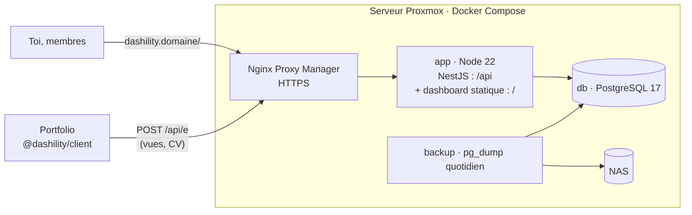
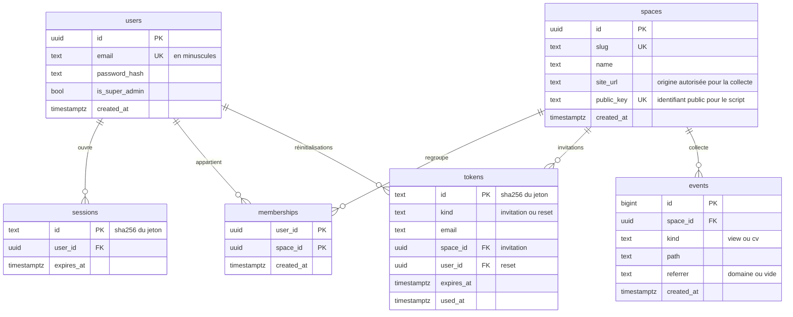

# Architecture technique

4 novembre 2026 · s'appuie sur `01-PRD.md`, `04-architecture-contenu-ux.md` et `decisions.md`

Ce document fixe comment la V1 (analytics) est construite. La V2 n'y est qu'esquissée, pour que la V1 ne la bloque pas.

## Vue d'ensemble



- **Un seul conteneur applicatif.** NestJS sert l'API sous `/api` et les fichiers compilés du dashboard sous `/`. Le dashboard et l'API sont sur la même origine, il n'y a donc pas de CORS pour le dashboard et le cookie de session reste en `SameSite=Strict`.
- **Ce qui est ouvert aux autres origines** : seul l'endpoint de collecte `/api/e` accepte les requêtes des sites, et seulement depuis l'URL déclarée de leur espace.
- **Pas de Redis ni de file d'attente.** Avec une seule instance et le trafic d'un portfolio, PostgreSQL et la mémoire du processus suffisent.

## Stack

| Brique | Choix |
| --- | --- |
| Langage | TypeScript strict partout, Node 22 LTS |
| Monorepo | npm workspaces |
| API | NestJS, `@nestjs/swagger` (OpenAPI sur `/api/docs`), `@nestjs/throttler`, `@nestjs/schedule` |
| Base | PostgreSQL 17, Drizzle ORM et drizzle-kit pour les migrations |
| Validation | Zod, schémas dans `packages/shared`, utilisés par l'API, le dashboard et le client |
| Mots de passe | Argon2id (paquet `argon2`) |
| Dashboard | Vue 3, Vite, Vue Router, Pinia, shadcn-vue, Tailwind CSS, graphiques shadcn-vue (Unovis) |
| Script de collecte | TypeScript sans dépendance, compilé par Vite en mode librairie |
| Tests | Vitest partout (l'API passe par SWC pour les décorateurs), Playwright pour le dashboard, PostgreSQL réel en CI pour les tests d'intégration |
| Qualité | ESLint, Prettier, `vue-tsc` et `tsc --noEmit` |
| Conteneurs | Image Docker multi-étapes, Docker Compose |

**Convention de nommage** : le code, la base et les routes de l'API sont en anglais, ce qui est l'usage courant pour un dépôt public. Les URLs du dashboard, l'interface et les commits sont en français.

## Organisation du monorepo

```
.
├── apps/
│   ├── api/
│   │   ├── src/
│   │   │   ├── main.ts
│   │   │   ├── cli.ts               # commandes serveur (création du super-admin)
│   │   │   ├── db/                  # schéma Drizzle, connexion
│   │   │   ├── auth/                # login, sessions, guards
│   │   │   ├── spaces/              # espaces, membres, invitations
│   │   │   ├── analytics/           # lecture, export CSV, SSE
│   │   │   └── collect/             # endpoint public /api/e
│   │   ├── drizzle/                 # migrations SQL générées
│   │   └── test/                    # tests d'intégration
│   └── dashboard/
│       └── src/
│           ├── pages/               # un fichier par écran du document UX
│           ├── components/          # composants shadcn-vue + composants maison
│           ├── composables/         # useApi, useSession, useLiveEvents…
│           ├── stores/              # Pinia : session
│           └── router.ts
├── packages/
│   ├── shared/                      # schémas Zod et types partagés
│   └── client/                      # package npm des sites (V1 : script analytics)
├── docker/
│   ├── Dockerfile
│   └── compose.yml
└── .github/workflows/ci.yml
```

## Modèle de données (V1)



- **Accès du super-admin** : il voit tous les espaces sans ligne dans `memberships`.
- **Index de `events`** : `(space_id, created_at)` couvre toutes les requêtes de l'onglet analytics.
- **Jetons et sessions** : on ne stocke que leur empreinte SHA-256. Une fuite de la base ne donne donc aucun jeton utilisable.
- **Dernier espace ouvert** : il est gardé dans le `localStorage` du dashboard, pas en base. Ce n'est qu'une commodité.
- **Suppression d'un espace** : en cascade sur ses `memberships`, `tokens` et `events`.

### Esquisse V2 (à détailler au début de la V2)

- `content_types` : `space_id`, `slug`, `name`, `kind` (`collection` ou `single`), `fields` en JSONB.
- `entries` : `type_id`, `status` (`draft` ou `published`), `data` en JSONB validé par un schéma Zod construit à partir de `fields`, `published_at`.
- `media` : `space_id`, chemin sur le NAS, texte alternatif FR et EN, variantes générées.
- `spaces` gagne `api_key_hash` et `deploy_url`.

## API (V1)

Toutes les routes sont préfixées par `/api`. Le corps des requêtes et les réponses sont en JSON, validés par Zod.

| Méthode et route | Accès | Rôle |
| --- | --- | --- |
| `POST /auth/login` | Public, limité en débit | Ouvre une session et pose le cookie |
| `POST /auth/logout` | Connecté | Supprime la session |
| `GET /auth/me` | Connecté | Utilisateur et liste de ses espaces |
| `PUT /auth/password` | Connecté | Change le mot de passe et ferme les autres sessions |
| `GET /tokens/:token` | Public | Vérifie un lien d'invitation ou de réinitialisation et renvoie son type et l'email |
| `POST /tokens/:token` | Public | Consomme le lien : `{ password }`, crée le compte ou change le mot de passe, ouvre une session |
| `GET /spaces` | Connecté | Espaces accessibles |
| `POST /spaces` | Super-admin | Crée un espace |
| `GET /spaces/:slug` | Membre | Détail d'un espace (la clé publique n'est renvoyée qu'au super-admin) |
| `PATCH /spaces/:slug` | Super-admin | Nom, slug, URL du site |
| `DELETE /spaces/:slug` | Super-admin | Supprime l'espace |
| `GET /spaces/:slug/members` | Super-admin | Membres et invitations en attente |
| `POST /spaces/:slug/invitations` | Super-admin | `{ email }` : renvoie le lien, ou ajoute directement un compte existant |
| `DELETE /spaces/:slug/invitations/:id` | Super-admin | Annule une invitation (en régénérer une = annuler puis recréer) |
| `DELETE /spaces/:slug/members/:userId` | Super-admin | Retire un membre |
| `POST /users/:id/password-reset` | Super-admin | Renvoie un lien de réinitialisation |
| `GET /spaces/:slug/analytics?from&to` | Membre | Totaux, série par jour, pages, provenances |
| `GET /spaces/:slug/analytics/export.csv?from&to` | Membre | Événements bruts de la période |
| `GET /spaces/:slug/analytics/live` | Membre | Flux SSE des nouveaux événements |
| `POST /e` | Public, CORS limité à `site_url` | Collecte d'un événement |
| `GET /health` | Public | Santé de l'API et de la base |

**Règles communes**

- Un espace auquel l'utilisateur n'a pas accès renvoie **404**, jamais 403 (document UX). C'est un seul guard, `SpaceAccessGuard`, qui charge l'espace par son slug et vérifie l'appartenance.
- Les erreurs suivent un format unique : `{ error: { code, message } }`.
- Les dates sont en ISO 8601 UTC. Les agrégations par jour se font dans le fuseau `Europe/Paris`.

## Authentification et sécurité

- **Sessions** : jeton aléatoire de 32 octets dans le cookie `dashility_session` (`HttpOnly`, `Secure`, `SameSite=Strict`, `Path=/`). En base, on ne garde que son empreinte. La session dure 14 jours et se prolonge à chaque usage.
- **Révocation** : changer ou réinitialiser un mot de passe supprime toutes les sessions du compte. Retirer un membre prend effet à la requête suivante, puisque l'appartenance est vérifiée à chaque requête.
- **CSRF** : on s'appuie sur `SameSite=Strict`, la même origine pour le dashboard et l'API, et le refus des requêtes qui modifient des données sans `Content-Type: application/json`.
- **Limitation du débit** : `/auth/login` accepte 5 tentatives par minute par IP et par email, et `/e` 60 événements par minute par IP. Les IP ne restent qu'en mémoire, jamais en base.
- **Liens à usage unique** : jeton de 32 octets, valable 72 h pour une invitation et 24 h pour une réinitialisation, et marqué `used_at` dès qu'il est consommé.
- **En-têtes** : Helmet, avec une CSP stricte sur le dashboard.
- **Premier super-admin** : il est créé par une commande serveur (`docker compose exec app node dist/cli.js create-super-admin <email>`), qui demande le mot de passe dans le terminal. Aucun secret ne passe par les variables d'environnement.

## Collecte analytics

### Script (`packages/client`)

```ts
import { initAnalytics } from '@dashility/client'
initAnalytics({ key: '<clé publique de l\'espace>', endpoint: 'https://dashility.domaine/api/e' })
```

- **Vues** : une vue au chargement de la page, puis une à chaque navigation SPA (interception de `history.pushState` et de `popstate`), car vite-ssg hydrate le site en application Vue.
- **CV** : un clic sur un lien portant l'attribut `data-dashility-cv` envoie un événement `cv`. Le script l'écoute par délégation sur `document`.
- **Envoi** : `navigator.sendBeacon` avec un corps `text/plain` qui contient du JSON. C'est une requête CORS simple, sans requête préalable, qui part même quand on quitte la page.
- **Données envoyées** : `{ k, t, p, r }`, soit la clé, le type, le chemin sans paramètres ni ancre, et le **domaine** de provenance. La provenance n'est envoyée qu'à la première vue de la visite et seulement si elle est externe.
- **Rien n'est envoyé** si le marqueur `dashility-ignore` est présent dans le `localStorage`, si `navigator.webdriver` est vrai, ou si le site tourne sur `localhost`.
- **Lien magique** : `?dashility-ignore=1` pose le marqueur, `?dashility-ignore=0` le retire. Le paramètre est ensuite effacé de l'URL et une confirmation discrète s'affiche.
- **Budget** : moins de 2 Ko compressé, vérifié en CI.
- L'endpoint s'appelle `/api/e` plutôt que `/collect` ou `/analytics`, des mots que les bloqueurs de publicité filtrent.

### Côté serveur

1. Le serveur cherche l'espace par `k`, puis rejette l'événement si l'en-tête `Origin` ne correspond pas à son `site_url`.
2. Il valide l'événement avec Zod : `t` vaut `view` ou `cv`, `p` fait 512 caractères au plus, `r` est un nom de domaine.
3. Il ignore les `User-Agent` de robots, avec une expression régulière des robots courants.
   `shortcut: liste de robots maison, passer au paquet isbot si des robots passent au travers`
4. Il insère l'événement dans `events` et le publie aux flux SSE ouverts sur cet espace.
5. Il répond toujours `204`, sans détail, même en cas de rejet.

- **Provenance** : elle est regroupée à la lecture, pas au stockage. `linkedin.com` et `lnkd.in` deviennent LinkedIn, `github.com` devient GitHub, `google.*` devient Google, une valeur vide devient « Accès direct », et les autres gardent leur domaine.
- **Temps réel** : un `EventEmitter` en mémoire relie la collecte aux flux SSE.
  `shortcut: diffusion en mémoire, valable pour une seule instance ; passer à LISTEN/NOTIFY de PostgreSQL si l'API est répliquée`
- **Rétention** : une tâche quotidienne (`@nestjs/schedule`, 3 h) supprime les événements de plus de 6 mois.
- **Lecture** : les agrégats sont calculés à la volée depuis `events`. Au volume d'un portfolio, aucune table d'agrégats n'est nécessaire.

## Dashboard

- Une page par écran du document UX, chargée à la demande par le routeur.
- Pinia ne contient que la session (`/auth/me`). Le reste est lu écran par écran via le composable `useApi`, un `fetch` typé par les schémas de `packages/shared`.
- Un garde de route envoie vers `/connexion?retour=…` si aucune session n'est ouverte.
- Le temps réel utilise `EventSource` sur `/api/spaces/:slug/analytics/live`, avec reconnexion automatique et un bouton pause.
- L'accessibilité vise WCAG 2.2 AA : composants shadcn-vue (Reka UI), une alternative en tableau pour la courbe, et des tests Playwright au clavier sur les parcours V1.

## Environnements et déploiement

| Environnement | Comment |
| --- | --- |
| Local | `docker compose up db`, puis `npm run dev` (API et dashboard en parallèle, Vite qui relaie `/api`) |
| CI | GitHub Actions sur chaque PR : `npm ci`, lint, types, tests avec un service PostgreSQL, build, poids du script |
| Production | Sur le serveur : `git pull`, puis `docker compose up -d --build`, à la main et uniquement sur ta décision |

`compose.yml` en production :

- `app` : l'image de l'API et du dashboard. Les migrations Drizzle s'appliquent au démarrage.
- `db` : `postgres:17`, avec un volume persistant.
- `backup` : un `pg_dump` quotidien vers le NAS, qui garde 7 sauvegardes.
- Nginx Proxy Manager, déjà en place, redirige `dashility.domaine` vers `app:3000`.

**Publication du package** : `packages/client` est publié sur npm à la main (`npm publish`) quand une version change. Il est publié sous `@dashility/client`, ce qui suppose d'avoir créé l'organisation `dashility` sur npm.
`shortcut: publication manuelle, passer à un workflow sur tag si les versions deviennent fréquentes`

## Ordre de construction de la V1

Chaque étape correspond à une branche et à une PR vers `dev`.

1. `chore/dev/init_monorepo` : workspaces, TypeScript, ESLint, Prettier, Vitest, CI.
2. `feat/dev/base_de_donnees` : Docker Compose local, schéma Drizzle, première migration.
3. `feat/dev/authentification` : commande super-admin, login, sessions, guards.
4. `feat/dev/espaces_membres` : espaces, invitations, réinitialisations.
5. `feat/dev/collecte` : endpoint `/api/e` et package client, publié et branché sur le portfolio.
6. `feat/dev/dashboard_base` : routeur, mise en page, connexion, invitation, réinitialisation, compte.
7. `feat/dev/onglet_analytics` : agrégats, écran analytics, export CSV, SSE.
8. `feat/dev/reglages_espace` : écran des réglages et lien magique « Ne pas me compter ».
9. `chore/dev/deploiement` : Dockerfile, compose de production, sauvegarde, README d'installation.

Faire la collecte (étape 5) avant le dashboard permet d'accumuler des données réelles le plus tôt possible.

## Risques

| Risque | Parade |
| --- | --- |
| Bloqueurs de publicité qui filtrent le script | Endpoint au nom neutre ; script bundlé dans le site, pas chargé depuis un domaine tiers |
| L'application LinkedIn n'envoie pas de provenance | Ces visites tombent dans « Accès direct » : limite connue, à signaler dans l'étude de cas |
| Le script dépasse 2 Ko | Aucune dépendance, vérification du poids en CI |
| CMS hors ligne | Les sites restent en ligne ; seuls les événements de cette période sont perdus (accepté par le PRD) |
| Perte du serveur | `pg_dump` quotidien sur le NAS |
| Mot de passe du super-admin oublié | La commande serveur permet aussi de le réinitialiser |
