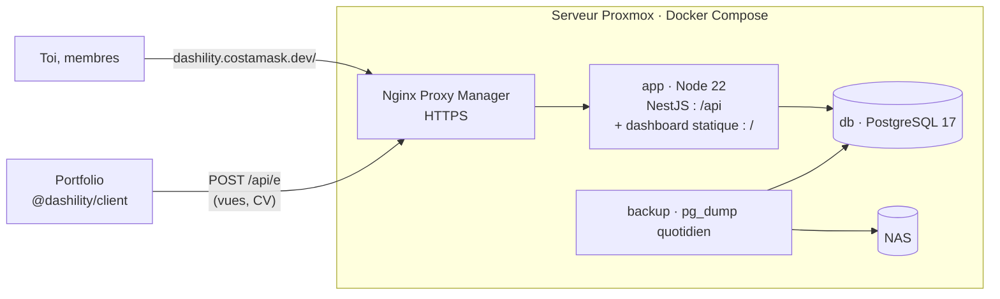
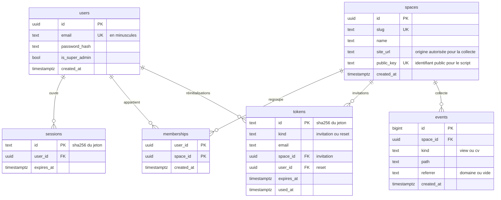
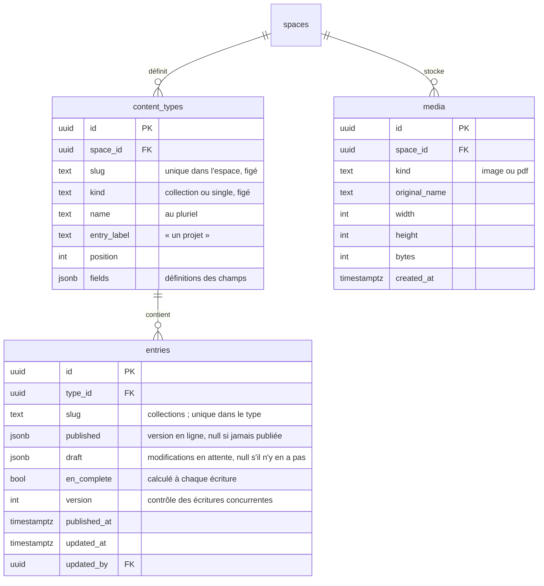

# Architecture technique

4 novembre 2026, complété le 6 novembre 2026 pour la V2 · s'appuie sur `01-PRD.md`, `04-architecture-contenu-ux.md` et `decisions.md`

Ce document fixe comment la V1 (analytics) est construite, puis la V2 (contenu) dans la section « V2 : contenu ».

## Vue d'ensemble



- **Un seul conteneur applicatif.** NestJS sert l'API sous `/api` et les fichiers compilés du dashboard sous `/`. Le dashboard et l'API sont sur la même origine, il n'y a donc pas de CORS pour le dashboard et le cookie de session reste en `SameSite=Strict`.
- **Ce qui est ouvert aux autres origines** : seul l'endpoint de collecte `/api/e` accepte les requêtes des sites, et seulement depuis l'URL déclarée de leur espace.
- **Pas de Redis ni de file d'attente.** Avec une seule instance et le trafic d'un portfolio, PostgreSQL et la mémoire du processus suffisent.

## Stack

| Brique | Choix |
| --- | --- |
| Langage | TypeScript strict partout, Node 22 LTS |
| Monorepo | npm workspaces |
| API | NestJS, `@nestjs/swagger` (OpenAPI sur `/api/docs`), `@nestjs/throttler`, `@nestjs/schedule` |
| Base | PostgreSQL 17, Drizzle ORM et drizzle-kit pour les migrations |
| Validation | Zod, schémas dans `packages/shared`, utilisés par l'API, le dashboard et le client |
| Mots de passe | Argon2id (paquet `argon2`) |
| Dashboard | Vue 3, Vite, Vue Router, Pinia, shadcn-vue, Tailwind CSS, graphiques shadcn-vue (Unovis) |
| Texte riche (V2) | Tiptap (`@tiptap/vue-3`) dans le dashboard, `@tiptap/html` dans l'API pour produire le HTML servi aux sites |
| Images (V2) | `sharp` : vérification du type réel, variantes WebP et AVIF |
| Script de collecte | TypeScript sans dépendance, compilé par Vite en mode librairie |
| Tests | Vitest partout (l'API passe par SWC pour les décorateurs), Playwright pour le dashboard, PostgreSQL réel en CI pour les tests d'intégration |
| Qualité | ESLint, Prettier, `vue-tsc` et `tsc --noEmit` |
| Conteneurs | Image Docker multi-étapes, Docker Compose |

**Convention de nommage** : le code, la base et les routes de l'API sont en anglais, ce qui est l'usage courant pour un dépôt public. Les URLs du dashboard, l'interface et les commits sont en français.

## Organisation du monorepo

```
.
├── apps/
│   ├── api/
│   │   ├── src/
│   │   │   ├── main.ts
│   │   │   ├── cli.ts               # commandes serveur (création du super-admin)
│   │   │   ├── db/                  # schéma Drizzle, connexion
│   │   │   ├── auth/                # login, sessions, guards
│   │   │   ├── spaces/              # espaces, membres, invitations
│   │   │   ├── analytics/           # lecture, export CSV, SSE
│   │   │   ├── collect/             # endpoint public /api/e
│   │   │   ├── content/             # V2 : types, entrées, publication
│   │   │   ├── media/               # V2 : envoi et service des images et des PDF
│   │   │   ├── public-api/          # V2 : API de lecture des sites (/api/v1)
│   │   │   └── deploy/              # V2 : appel de l'URL de déploiement
│   │   ├── drizzle/                 # migrations SQL générées
│   │   └── test/                    # tests d'intégration
│   └── dashboard/
│       └── src/
│           ├── pages/               # un fichier par écran du document UX
│           ├── components/          # composants shadcn-vue + composants maison
│           ├── composables/         # useApi, useSession, useLiveEvents…
│           ├── stores/              # Pinia : session
│           └── router.ts
├── packages/
│   ├── shared/                      # schémas Zod et types partagés
│   └── client/                      # package npm des sites (V1 : script analytics)
├── docker/
│   ├── Dockerfile
│   └── compose.yml
└── .github/workflows/ci.yml
```

## Modèle de données (V1)



- **Accès du super-admin** : il voit tous les espaces sans ligne dans `memberships`.
- **Index de `events`** : `(space_id, created_at)` couvre toutes les requêtes de l'onglet analytics.
- **Jetons et sessions** : on ne stocke que leur empreinte SHA-256. Une fuite de la base ne donne donc aucun jeton utilisable.
- **Dernier espace ouvert** : il est gardé dans le `localStorage` du dashboard, pas en base. Ce n'est qu'une commodité.
- **Suppression d'un espace** : en cascade sur ses `memberships`, `tokens` et `events`.

Le modèle de données de la V2 est décrit dans la section « V2 : contenu ».

## API (V1)

Toutes les routes sont préfixées par `/api`. Le corps des requêtes et les réponses sont en JSON, validés par Zod.

| Méthode et route | Accès | Rôle |
| --- | --- | --- |
| `POST /auth/login` | Public, limité en débit | Ouvre une session et pose le cookie |
| `POST /auth/logout` | Connecté | Supprime la session |
| `GET /auth/me` | Connecté | Utilisateur et liste de ses espaces |
| `PUT /auth/password` | Connecté | Change le mot de passe et ferme les autres sessions |
| `GET /tokens/:token` | Public | Vérifie un lien d'invitation ou de réinitialisation et renvoie son type et l'email |
| `POST /tokens/:token` | Public | Consomme le lien : `{ password }`, crée le compte ou change le mot de passe, ouvre une session |
| `GET /spaces` | Connecté | Espaces accessibles |
| `POST /spaces` | Super-admin | Crée un espace |
| `GET /spaces/:slug` | Membre | Détail d'un espace (la clé publique n'est renvoyée qu'au super-admin) |
| `PATCH /spaces/:slug` | Super-admin | Nom, slug, URL du site |
| `DELETE /spaces/:slug` | Super-admin | Supprime l'espace |
| `GET /spaces/:slug/members` | Super-admin | Membres et invitations en attente |
| `POST /spaces/:slug/invitations` | Super-admin | `{ email }` : renvoie le lien, ou ajoute directement un compte existant |
| `DELETE /spaces/:slug/invitations/:id` | Super-admin | Annule une invitation (en régénérer une = annuler puis recréer) |
| `DELETE /spaces/:slug/members/:userId` | Super-admin | Retire un membre |
| `POST /users/:id/password-reset` | Super-admin | Renvoie un lien de réinitialisation |
| `GET /spaces/:slug/analytics?from&to` | Membre | Totaux, série par jour, pages, provenances |
| `GET /spaces/:slug/analytics/export.csv?from&to` | Membre | Événements bruts de la période |
| `GET /spaces/:slug/analytics/live` | Membre | Flux SSE des nouveaux événements |
| `POST /e` | Public, CORS limité à `site_url` | Collecte d'un événement |
| `GET /health` | Public | Santé de l'API et de la base |

**Règles communes**

- Un espace auquel l'utilisateur n'a pas accès renvoie **404**, jamais 403 (document UX). C'est un seul guard, `SpaceAccessGuard`, qui charge l'espace par son slug et vérifie l'appartenance.
- Les erreurs suivent un format unique : `{ error: { code, message } }`.
- Les dates sont en ISO 8601 UTC. Les agrégations par jour se font dans le fuseau `Europe/Paris`.

## Authentification et sécurité

- **Sessions** : jeton aléatoire de 32 octets dans le cookie `dashility_session` (`HttpOnly`, `Secure`, `SameSite=Strict`, `Path=/`). En base, on ne garde que son empreinte. La session dure 14 jours et se prolonge à chaque usage.
- **Révocation** : changer ou réinitialiser un mot de passe supprime toutes les sessions du compte. Retirer un membre prend effet à la requête suivante, puisque l'appartenance est vérifiée à chaque requête.
- **CSRF** : on s'appuie sur `SameSite=Strict`, la même origine pour le dashboard et l'API, et le refus des requêtes qui modifient des données sans `Content-Type: application/json`.
- **Limitation du débit** : `/auth/login` accepte 5 tentatives par minute par IP et par email, et `/e` 60 événements par minute par IP. Les IP ne restent qu'en mémoire, jamais en base.
- **Liens à usage unique** : jeton de 32 octets, valable 72 h pour une invitation et 24 h pour une réinitialisation, et marqué `used_at` dès qu'il est consommé.
- **En-têtes** : Helmet, avec une CSP stricte sur le dashboard.
- **Premier super-admin** : il est créé par une commande serveur (`docker compose exec app node dist/cli.js create-super-admin <email>`), qui demande le mot de passe dans le terminal. Aucun secret ne passe par les variables d'environnement.

## Collecte analytics

### Script (`packages/client`)

```ts
import { initAnalytics } from '@dashility/client'
initAnalytics({ key: '<clé publique de l\'espace>', endpoint: 'https://dashility.costamask.dev/api/e' })
```

- **Vues** : une vue au chargement de la page, puis une à chaque navigation SPA (interception de `history.pushState` et de `popstate`), car vite-ssg hydrate le site en application Vue.
- **CV** : un clic sur un lien portant l'attribut `data-dashility-cv` envoie un événement `cv`. Le script l'écoute par délégation sur `document`.
- **Envoi** : `navigator.sendBeacon` avec un corps `text/plain` qui contient du JSON. C'est une requête CORS simple, sans requête préalable, qui part même quand on quitte la page.
- **Données envoyées** : `{ k, t, p, r }`, soit la clé, le type, le chemin sans paramètres ni ancre, et le **domaine** de provenance. La provenance n'est envoyée qu'à la première vue de la visite et seulement si elle est externe.
- **Rien n'est envoyé** si le marqueur `dashility-ignore` est présent dans le `localStorage`, si `navigator.webdriver` est vrai, ou si le site tourne sur `localhost`.
- **Lien magique** : `?dashility-ignore=1` pose le marqueur, `?dashility-ignore=0` le retire. Le paramètre est ensuite effacé de l'URL et une confirmation discrète s'affiche.
- **Budget** : moins de 2 Ko compressé, vérifié en CI.
- L'endpoint s'appelle `/api/e` plutôt que `/collect` ou `/analytics`, des mots que les bloqueurs de publicité filtrent.

### Côté serveur

1. Le serveur cherche l'espace par `k`, puis rejette l'événement si l'en-tête `Origin` ne correspond pas à son `site_url`.
2. Il valide l'événement avec Zod : `t` vaut `view` ou `cv`, `p` fait 512 caractères au plus, `r` est un nom de domaine.
3. Il ignore les `User-Agent` de robots, avec une expression régulière des robots courants.
   `shortcut: liste de robots maison, passer au paquet isbot si des robots passent au travers`
4. Il insère l'événement dans `events` et le publie aux flux SSE ouverts sur cet espace.
5. Il répond toujours `204`, sans détail, même en cas de rejet.

- **Provenance** : elle est regroupée à la lecture, pas au stockage. `linkedin.com` et `lnkd.in` deviennent LinkedIn, `github.com` devient GitHub, `google.*` devient Google, une valeur vide devient « Accès direct », et les autres gardent leur domaine.
- **Temps réel** : un `EventEmitter` en mémoire relie la collecte aux flux SSE.
  `shortcut: diffusion en mémoire, valable pour une seule instance ; passer à LISTEN/NOTIFY de PostgreSQL si l'API est répliquée`
- **Rétention** : une tâche quotidienne (`@nestjs/schedule`, 3 h) supprime les événements de plus de 6 mois.
- **Lecture** : les agrégats sont calculés à la volée depuis `events`. Au volume d'un portfolio, aucune table d'agrégats n'est nécessaire.

## Dashboard

- Une page par écran du document UX, chargée à la demande par le routeur.
- Pinia ne contient que la session (`/auth/me`). Le reste est lu écran par écran via le composable `useApi`, un `fetch` typé par les schémas de `packages/shared`.
- Un garde de route envoie vers `/connexion?retour=…` si aucune session n'est ouverte.
- Le temps réel utilise `EventSource` sur `/api/spaces/:slug/analytics/live`, avec reconnexion automatique et un bouton pause.
- L'accessibilité vise WCAG 2.2 AA : composants shadcn-vue (Reka UI), une alternative en tableau pour la courbe, et des tests Playwright au clavier sur les parcours V1.

## V2 : contenu

S'appuie sur le document UX, section « Écrans V2 », et sur les décisions du 6 novembre 2026.

### Modèle de données



`spaces` gagne `api_key_hash`, `api_key_created_at`, `deploy_url`, `deploy_token` et le résultat du dernier appel (`deploy_called_at`, `deploy_status`).

**Statut d'une entrée**, déduit des deux colonnes JSONB, sans colonne `status` qui pourrait les contredire :

| `published` | `draft` | Statut (document UX) |
| --- | --- | --- |
| null | rempli | Brouillon |
| rempli | null | Publié |
| rempli | rempli | Publié, avec des modifications en attente |

- **Sauvegarde automatique** : elle écrit toujours dans `draft`. « Publier » copie `draft` dans `published` et vide `draft` ; « Annuler les modifications » vide `draft` ; « Dépublier » remet `published` dans `draft` et vide `published`. Le site ne lit que `published`.
- **Écritures concurrentes** : chaque écriture envoie la `version` lue ; si elle ne correspond plus, l'API répond `409` et l'éditeur affiche « Recharger la dernière version ».
- **Ordre des types** : `position`, modifiable dans Structure. L'ordre des entrées est laissé aux sites (PRD).

### Définition des champs et valeurs

`fields` est un tableau, validé par un schéma Zod de `packages/shared` :

```ts
type Field = {
  key: string          // identifiant, figé ; sert de clé dans les valeurs et dans l'API
  label: string
  type: 'text' | 'richtext' | 'choice' | 'date' | 'link' | 'list' | 'number' | 'boolean' | 'image' | 'pdf' | 'group'
  required: boolean
  translatable: boolean // figé ; ignoré pour group, porté par les sous-champs
  options?: …           // selon le type : maxLength, choix { key, fr, en }, période et précision, min et max d'un groupe, sous-champs
}
```

- **Valeurs** : un objet indexé par `key`. Un champ traduisible vaut `{ fr, en }`, un champ non traduisible vaut sa valeur. Un groupe vaut un tableau d'objets, construits de la même façon pour ses sous-champs : les éléments sont communs aux deux langues (document UX).
- **Valeurs par type** : `choice` garde la clé du choix (le libellé vient de la définition), `date` vaut `{ start, end?, ongoing? }` en ISO (`2026-10`), `image` vaut `{ id, alt: { fr, en } }`, `pdf` vaut l'`id` du fichier (un par langue si traduisible), `richtext` vaut un document Tiptap (JSON).
- **Un seul schéma Zod, construit à partir de `fields`**, sert à l'API et au dashboard, en deux modes : *brouillon* (types et formats seulement, tout peut être vide) et *publication* (champs obligatoires en français, en plus). `en_complete` vérifie les champs obligatoires traduisibles en anglais.
- **Modification de la structure** : supprimer un champ retire sa clé de `published` et de `draft` de toutes les entrées du type, dans une transaction. Ajouter un champ obligatoire ne touche pas aux entrées : la règle s'applique à la prochaine publication (document UX). Ce qui est figé est refusé par l'API, pas seulement masqué dans le dashboard.

### Texte riche

- **Saisie** : Tiptap, limité aux extensions du document UX (paragraphe, gras, italique, lien, listes, intertitre `h2` et `h3`, mise en avant). Le collage ne garde que ces éléments, puisque Tiptap retire ce que son schéma ne connaît pas.
- **Stockage** : le document JSON de Tiptap. L'API le valide contre la même liste de nœuds et de marques ; un lien doit être en `http(s)` ou `mailto`.
- **Lecture par les sites** : l'API publique renvoie du HTML généré à partir du JSON par `@tiptap/html`, avec les mêmes extensions. Le HTML ne contient donc que ces balises, et le texte est échappé. La mise en avant devient `<mark>` ; le site lui donne son style.

### Médias

- **Stockage** : sur le NAS, dans `/mnt/nas/media/dashility/medias`, monté dans le conteneur `app` en `/data/medias` (variable `MEDIA_DIR`), avec `create_host_path: false` comme pour les sauvegardes. Un fichier par dossier : `<espace>/<id>/original.<ext>`, et pour une image `640.webp`, `640.avif`, `1280.webp`… Le NAS est en RAID : une panne de disque ne perd rien.
- **Envoi** : `POST /api/spaces/:slug/media` en `multipart/form-data` (multer, déjà fourni par `@nestjs/platform-express`), 10 Mo au plus. Le type réel est vérifié : `sharp` doit savoir lire une image (JPEG, PNG ou WebP), et un PDF doit commencer par `%PDF-`. Le nom du fichier n'est jamais utilisé comme chemin.
- **Variantes** : à l'envoi, en WebP et en AVIF, en 640, 1280 et 1920 px de large, sans agrandir une image plus petite. Les métadonnées EXIF (lieu de la photo) sont retirées.
- **Service** : `GET /api/media/:id/:fichier`, public, avec `Cache-Control: public, max-age=31536000, immutable`. Un nouveau fichier a toujours un nouvel `id`, donc une adresse en cache n'a jamais besoin d'être invalidée.
  `shortcut: un média est public dès qu'il est envoyé, même s'il n'est utilisé que dans un brouillon ; son id (UUID aléatoire) ne se devine pas. Servir seulement les médias publiés si un espace a du contenu confidentiel`
- **Fichiers orphelins** : remplacer ou retirer une image n'efface rien tout de suite, puisque `published` peut encore l'utiliser. Une tâche quotidienne supprime les médias de plus de 24 h qui n'apparaissent ni dans `published` ni dans `draft` d'aucune entrée de leur espace.
- **NAS injoignable** : l'envoi répond `503` (« Le stockage des fichiers est indisponible »), le service répond `404`. L'édition du texte continue.
- **Sauvegarde** : les fichiers ne sont pas dans le `pg_dump`. Ils sont protégés des pannes de disque par le RAID du NAS, pas d'une suppression : les instantanés (snapshots) du QNAP sur ce dossier, s'ils sont activés, couvrent ce cas. Risque accepté (PRD : « une perte de données est acceptable »).

### API du dashboard (V2)

Mêmes règles que la V1 : session, `SpaceAccessGuard`, 404 pour un espace inaccessible, format d'erreur unique.

| Méthode et route | Accès | Rôle |
| --- | --- | --- |
| `GET /spaces/:slug/types` | Membre | Types de l'espace, avec leurs compteurs (entrées, publiées, EN incomplet) ; chaque route qui renvoie un type renvoie aussi ses compteurs |
| `POST /spaces/:slug/types` | Super-admin | Crée un type |
| `PUT /spaces/:slug/types/:type` | Super-admin | Enregistre le type (noms, champs, ordre) ; refuse ce qui est figé |
| `DELETE /spaces/:slug/types/:type` | Super-admin | Supprime le type et ses entrées |
| `PUT /spaces/:slug/type-order` | Super-admin | Ordre des types (hors de `/types/`, où `order` pourrait être un type) |
| `GET /spaces/:slug/types/:type/entries` | Membre | Liste : id, titre, slug, statut, EN complet, date de modification (le filtre par statut se fait dans le dashboard) |
| `POST /spaces/:slug/types/:type/entries` | Membre | Crée une entrée (brouillon) |
| `GET /spaces/:slug/types/:type/entries/:id` | Membre | Entrée complète (`published`, `draft`, `version`) ; pour une page unique, `:id` vaut `single` |
| `PATCH /spaces/:slug/types/:type/entries/:id` | Membre | Sauvegarde automatique : `{ version, data, slug? }` dans `draft` |
| `POST /spaces/:slug/types/:type/entries/:id/publish` | Membre | Publie le brouillon (validation complète) |
| `POST /spaces/:slug/types/:type/entries/:id/discard` | Membre | Annule les modifications en attente |
| `POST /spaces/:slug/types/:type/entries/:id/unpublish` | Membre | Dépublie |
| `DELETE /spaces/:slug/types/:type/entries/:id` | Membre | Supprime (sauf une page unique) |
| `POST /spaces/:slug/media` | Membre | Envoie une image ou un PDF |
| `POST /spaces/:slug/api-key` | Super-admin | Génère ou régénère la clé ; la renvoie une seule fois |
| `PUT /spaces/:slug/deploy` | Super-admin | `{ url, token? }` |
| `POST /spaces/:slug/deploy` | Super-admin | Lance un déploiement tout de suite |

- **Ce qui est réservé au super-admin est vérifié par l'API**, pas seulement caché dans le dashboard.
- **Publier, dépublier ou supprimer une entrée publiée** demande un déploiement (voir plus bas).

### API publique de lecture (`/api/v1`)

```
GET /api/v1/content/:type?locale=fr          collection : tableau des entrées publiées ; page unique : l'entrée
GET /api/v1/content/:type/:slug?locale=fr    une entrée d'une collection
Authorization: Bearer <clé API de l'espace>
```

- **La clé identifie l'espace**, il n'y a donc pas d'espace dans l'URL. Elle fait 32 octets aléatoires, préfixée par `dly_` pour être reconnue dans un dépôt de code par erreur ; on ne stocke que son empreinte SHA-256, comme les sessions.
- **Lecture côté serveur uniquement** : elle sert au build des sites (GitHub Actions) ou à leur serveur. Pas de CORS, puisque la clé ne doit jamais être dans un navigateur.
- **Réponse résolue pour la langue** : un champ traduisible renvoie la valeur de `locale` ; un choix renvoie `{ key, label }` ; le texte riche renvoie `{ html }` ; une image renvoie `{ alt, width, height, src, srcset: { webp, avif } }` avec des URL absolues ; un PDF renvoie `{ url, bytes }`.
- **`locale=en`** n'inclut que les entrées dont la version anglaise est complète (PRD, « Langues »).
- **Valeur par défaut** : un champ « oui / non » jamais touché n'a pas de valeur enregistrée ; l'API renvoie sa valeur par défaut, celle que l'éditeur affiche.
- **Chaque entrée** porte aussi `slug` (collections), `publishedAt` et `updatedAt`.
- Limitée à 120 requêtes par minute par clé. Documentée en OpenAPI sur `/api/docs` (`@nestjs/swagger`, prévu dans la stack depuis la V1 et pas encore en place, arrive avec cette API).

### Déploiement à la publication

- **Appel** : `POST deploy_url` avec le corps JSON `{ "event_type": "dashility-publish", "client_payload": { "space": "<slug>" } }` et, si un jeton est enregistré, l'en-tête `Authorization: Bearer <jeton>`. Ce format est celui de `repository_dispatch` de GitHub ; les hooks de build qui n'attendent rien (Netlify, Vercel…) ignorent le corps.
- **Regroupement** : l'appel part 10 secondes après la dernière publication de l'espace. Publier trois entrées à la suite ne lance qu'un build.
  `shortcut: minuteur en mémoire, perdu si l'API redémarre pendant ces 10 s et valable pour une seule instance ; le bouton « Lancer un déploiement » rattrape le cas`
- **Résultat** : le statut HTTP (ou « injoignable ») et l'heure sont enregistrés sur l'espace et affichés dans l'éditeur. Délai de 10 s, pas de nouvel essai automatique : le bouton « Relancer » suffit.
- **Sécurité** : `deploy_url` doit être en `https`, et seul le super-admin la règle. Le jeton n'est jamais renvoyé par l'API après son enregistrement (l'écran affiche « Jeton enregistré »). Il est stocké en clair, puisqu'il faut l'envoyer ; il doit donc avoir le moins de droits possible (pour GitHub : un jeton à grain fin limité au dépôt du site, permission « Contents » en écriture, la seule qui autorise `repository_dispatch`).

### Le portfolio (migration, dans son propre dépôt)

À faire après la V2, sur demande du propriétaire :

- `.github/workflows/contenu.yml` sur `repository_dispatch` (`dashility-publish`) : il lit le contenu par l'API publique (clé dans un secret GitHub), télécharge les images, build et publie l'image Docker sans relancer les tests. Les images restent servies par le site lui-même : sa CSP `img-src 'self'` ne change pas.
- **Objectif de moins de 5 minutes** (PRD) : environ 2 à 3 min de build, puis la tâche cron du serveur. Elle passe de 5 minutes à 1 minute pour le portfolio, sinon l'attente seule peut dépasser l'objectif.
- Le contenu Markdown et TypeScript actuel est recopié dans les types du document UX, puis lu par l'API au build.

## Environnements et déploiement

| Environnement | Comment |
| --- | --- |
| Local | `docker compose up db`, puis `npm run dev` (API et dashboard en parallèle, Vite qui relaie `/api`) |
| CI | GitHub Actions sur chaque PR : `npm ci`, lint, types, tests avec un service PostgreSQL, build, poids du script |
| Production | Automatique à chaque release mergée sur `main` : l'image est publiée sur GHCR, le serveur la récupère tout seul (même méthode que le portfolio) |

**Mise en ligne** : au merge sur `main` (le merge de la PR de release vaut confirmation), `deploiement.yml` relance les vérifications du CI, puis publie l'image `ghcr.io/k0konut/dashility` (paquet public) en `latest` et avec l'empreinte du commit. Sur le serveur, une tâche cron lance toutes les 5 minutes `docker compose up -d --pull always --quiet-pull` dans `/srv/docker/Projects/dashility`, ce qui ne recrée le conteneur que si l'image a changé. GitHub n'a aucun accès au serveur : pas de runner, pas de clé SSH. Retour arrière : `IMAGE_TAG=<commit>` dans le `.env` de ce dossier.

`docker/compose.prod.yml` (copié en `compose.yml` dans ce dossier) :

- `app` : l'image de l'API et du dashboard. Les migrations Drizzle s'appliquent au démarrage. En V2, le dossier des médias du NAS y est monté (`/data/medias`).
- `db` : `postgres:17`, avec un volume persistant.
- `backup` : un `pg_dump` quotidien vers le NAS (`/mnt/nas/media/backups/dashility`, monté en NFS sur le serveur), qui garde 7 sauvegardes.
- Nginx Proxy Manager, déjà en place, redirige `dashility.costamask.dev` vers `app:3000`.

**Publication du package** : `packages/client` est publié sur npm à la main (`npm publish`) quand une version change. Il est publié sous `@dashility/client`, ce qui suppose d'avoir créé l'organisation `dashility` sur npm.
`shortcut: publication manuelle, passer à un workflow sur tag si les versions deviennent fréquentes`

## Ordre de construction de la V1

Chaque étape correspond à une branche et à une PR vers `dev`.

1. `chore/dev/init_monorepo` : workspaces, TypeScript, ESLint, Prettier, Vitest, CI.
2. `feat/dev/base_de_donnees` : Docker Compose local, schéma Drizzle, première migration.
3. `feat/dev/authentification` : commande super-admin, login, sessions, guards.
4. `feat/dev/espaces_membres` : espaces, invitations, réinitialisations.
5. `feat/dev/collecte` : endpoint `/api/e` et package client, publié et branché sur le portfolio.
6. `feat/dev/dashboard_base` : routeur, mise en page, connexion, invitation, réinitialisation, compte.
7. `feat/dev/onglet_analytics` : agrégats, écran analytics, export CSV, SSE.
8. `feat/dev/reglages_espace` : écran des réglages et lien magique « Ne pas me compter ».
9. `chore/dev/deploiement` : Dockerfile, compose de production, sauvegarde, publication de l'image sur GHCR, README d'installation.

Faire la collecte (étape 5) avant le dashboard permet d'accumuler des données réelles le plus tôt possible.

## Risques

| Risque | Parade |
| --- | --- |
| Bloqueurs de publicité qui filtrent le script | Endpoint au nom neutre ; script bundlé dans le site, pas chargé depuis un domaine tiers |
| L'application LinkedIn n'envoie pas de provenance | Ces visites tombent dans « Accès direct » : limite connue, à signaler dans l'étude de cas |
| Le script dépasse 2 Ko | Aucune dépendance, vérification du poids en CI |
| CMS hors ligne | Les sites restent en ligne ; seuls les événements de cette période sont perdus (accepté par le PRD) |
| Perte du serveur | `pg_dump` quotidien sur le NAS |
| Mot de passe du super-admin oublié | La commande serveur permet aussi de le réinitialiser |

## Ordre de construction de la V2

Même principe : une branche et une PR vers `dev` par étape, et chaque étape laisse le dashboard utilisable.

1. `feat/dev/types_contenu` : tables, schéma Zod des champs, API et écran Structure.
2. `feat/dev/entrees` : API des entrées, écrans Contenu, liste et éditeur, avec les champs simples (texte court, choix, date, lien, liste de valeurs, nombre, oui / non, groupe répétable), la sauvegarde automatique et les écritures concurrentes.
3. `feat/dev/publication` : publier, annuler les modifications, dépublier, supprimer, contrôles de publication et EN incomplet.
4. `feat/dev/texte_riche` : Tiptap dans l'éditeur et validation côté API.
5. `feat/dev/medias` : envoi, variantes, service, nettoyage, champs image et PDF, montage du NAS dans le compose de production.
6. `feat/dev/api_publique` : clé API, `/api/v1`, HTML du texte riche, OpenAPI.
7. `feat/dev/deploiement_publication` : URL de déploiement, regroupement, état dans l'éditeur et dans Réglages.

Puis la release, et la migration du portfolio (dans son dépôt), à la demande du propriétaire.
